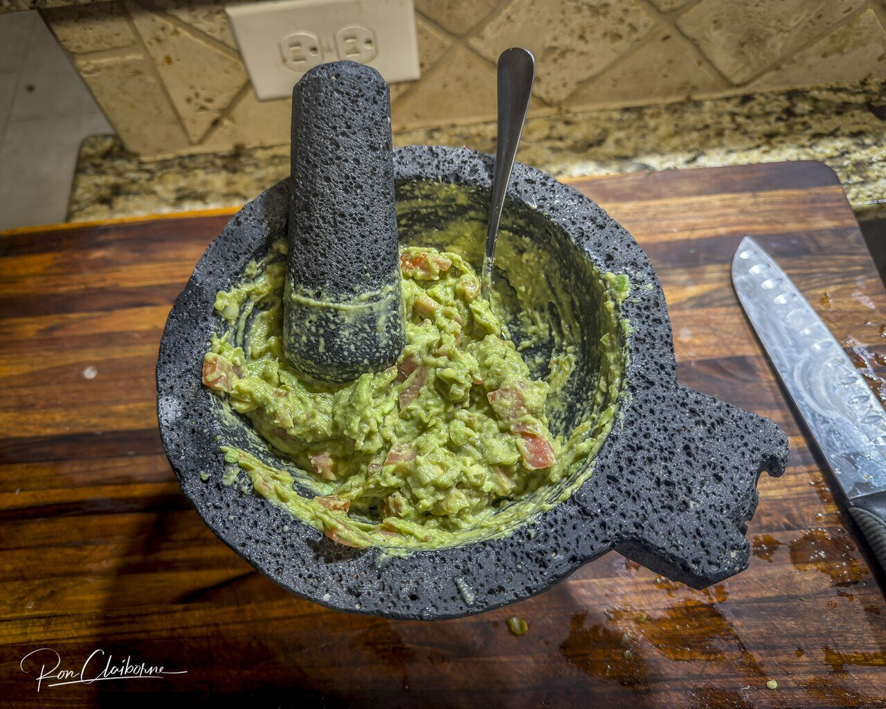

# Guacamole

*Foto: [Jazz Guy from College Station, Texas, United States](https://commons.wikimedia.org/wiki/File:Guacamole_tradicional.jpg), [CC BY 4.0](https://creativecommons.org/licenses/by/4.0/deed.es), vía Wikimedia Commons.*

Aguacate machacado en el molcajete con cebolla, tomate, cilantro y lima. El chile es opcional y sin semillas, así que pica muy poco.

🥄 Para **4 personas** · ⏱️ 10 minutos · Dificultad: fácil · Picor: suave

*In English:* [Guacamole](guacamole.en.md)

## Ingredientes

- 3 aguacates maduros
- ¼ de cebolla blanca
- 1 tomate maduro
- 1 puñado de cilantro
- El zumo de 1 lima
- ½ chile serrano o jalapeño sin semillas (opcional)
- Sal

## Preparación

1. **La base.** En el molcajete (o un bol), machaca la cebolla picada, el chile, si lo usas, y la mitad del cilantro con una pizca de sal hasta tener una pasta.
2. **El aguacate.** Añade la pulpa de los aguacates y machácala con un tenedor o la mano del molcajete, dejando algunos trozos.
3. **El resto.** Añade el tomate en dados pequeños, sin semillas, el resto del cilantro picado y el zumo de lima.
4. **Probar.** Ajusta de sal y lima y sírvelo enseguida.

## Consejos

- **Para que no se oscurezca:** cúbrelo con film pegado a la superficie.
- **Sin nada de picante:** quita el chile; el sabor sigue siendo el de un buen guacamole.
- **Con** totopos, tacos, frijoles o carne asada.
