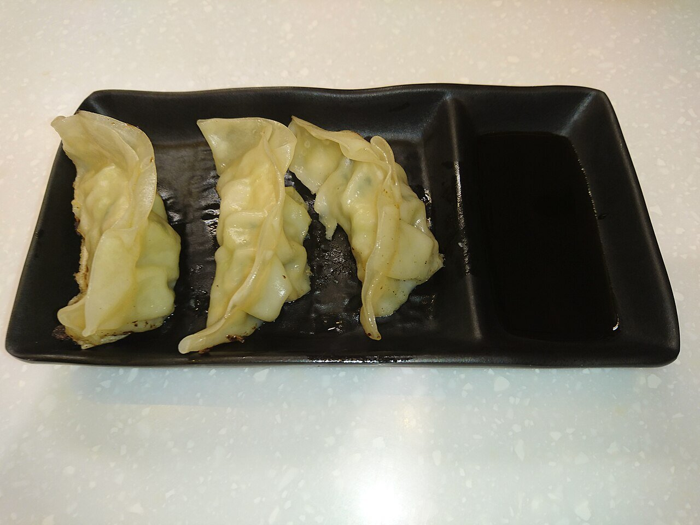

# Gyoza dipping sauce

*Photo: [Ceeseven](https://commons.wikimedia.org/wiki/File:Japanese_Gyoza_with_Soy_Sauce_in_Hong_Kong.jpg), [CC BY-SA 4.0](https://creativecommons.org/licenses/by-sa/4.0/), via Wikimedia Commons.*

Soy sauce, rice vinegar and a few drops of sesame oil: the dipping sauce for Japanese gyoza dumplings.

🥄 Serves **4** · ⏱️ 2 minutes · Difficulty: easy

*En español:* [Salsa para gyozas (gyoza no tare)](gyoza.es.md)

## Ingredients

- 3 tablespoons soy sauce
- 2 tablespoons rice vinegar
- ½ teaspoon toasted sesame oil
- A few drops rayu (Japanese chili oil), optional
- 1 teaspoon grated ginger or chopped scallion (optional)

## Directions

1. **Mix.** Stir the soy sauce and vinegar together in a small bowl.
2. **Sesame.** Add the sesame oil and, if you like, the rayu.
3. **Serve.** Divide among small dishes, topped with the ginger or scallion.

## Tips

- **Ratio:** the classic is half soy sauce, half vinegar; adjust to taste.
- **Not spicy:** skip the rayu, which is made with chiles.
- **Also with** dumplings, spring rolls or fried tofu.
