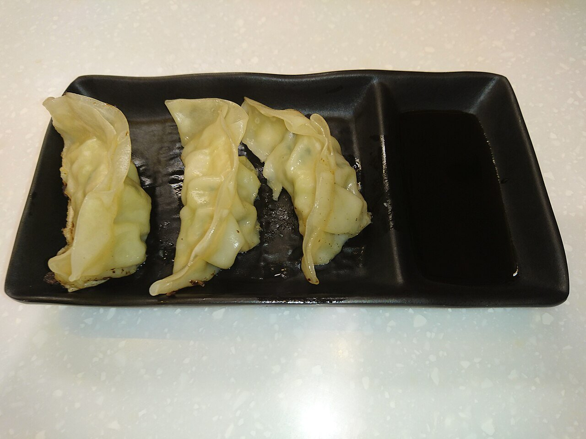

# Salsa para gyozas (gyoza no tare)

*Foto: [Ceeseven](https://commons.wikimedia.org/wiki/File:Japanese_Gyoza_with_Soy_Sauce_in_Hong_Kong.jpg), [CC BY-SA 4.0](https://creativecommons.org/licenses/by-sa/4.0/deed.es), vía Wikimedia Commons.*

Salsa de soja, vinagre de arroz y unas gotas de aceite de sésamo: la salsa para mojar las gyozas.

🥄 Para **4 personas** · ⏱️ 2 minutos · Dificultad: fácil

*In English:* [Gyoza dipping sauce](gyoza.en.md)

## Ingredientes

- 3 cucharadas de salsa de soja
- 2 cucharadas de vinagre de arroz
- ½ cucharadita de aceite de sésamo tostado
- Unas gotas de rayu (aceite picante japonés), opcional
- 1 cucharadita de jengibre rallado o de cebolleta picada (opcional)

## Preparación

1. **Mezclar.** Mezcla la soja y el vinagre en un cuenco pequeño.
2. **El sésamo.** Añade el aceite de sésamo y, si quieres, el rayu.
3. **Servir.** Reparte en platitos individuales, con el jengibre o la cebolleta por encima.

## Consejos

- **Proporción:** la clásica es mitad soja y mitad vinagre; ajústala a tu gusto.
- **Sin picante:** prescinde del rayu, que lleva guindilla.
- **También con** dumplings, harumaki o tofu frito.
