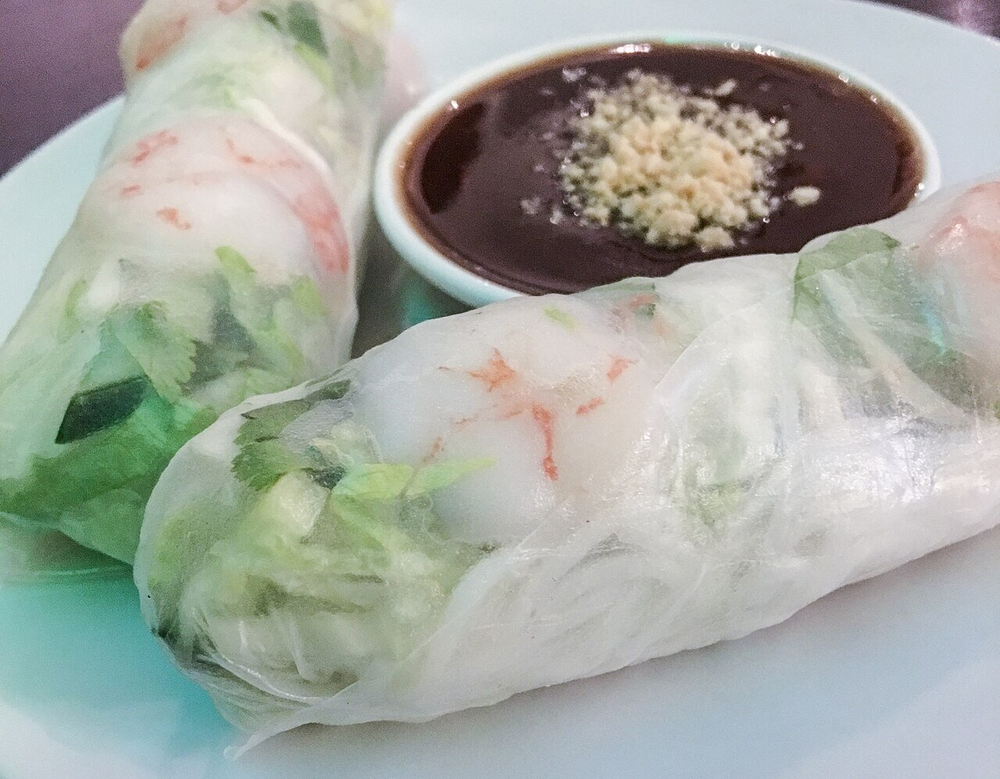

# Hoisin sauce

*Photo: [Alice Wiegand](https://commons.wikimedia.org/wiki/File:Sommerrolle_mit_Hoisin-Sauce_170305_AW.jpg), [CC BY-SA 4.0](https://creativecommons.org/licenses/by-sa/4.0/), via Wikimedia Commons.*

Soy sauce, sesame paste or peanut butter, sugar, vinegar, garlic and five-spice: a thick, sweet and salty sauce for Peking duck, rolls and stir-fries. The photo shows rolls with hoisin for dipping.

🥄 Makes **1 small jar** (about ⅔ cup) · ⏱️ 10 minutes · Difficulty: easy

*En español:* [Salsa hoisin](hoisin.es.md)

## Ingredients

- 4 tablespoons soy sauce
- 2 tablespoons sesame paste (or peanut butter)
- 2 tablespoons brown sugar (or agave syrup)
- 1 tablespoon red miso or black bean paste
- 2 teaspoons rice vinegar
- 1 garlic clove, grated
- 1 teaspoon toasted sesame oil
- ¼ teaspoon Chinese five-spice powder
- 1 to 2 tablespoons water

## Directions

1. **Mix.** Put all the ingredients except the water in a bowl.
2. **Whisk.** Whisk until the sesame paste is fully blended and smooth.
3. **Heat.** To thicken and bind it, simmer 2 to 3 minutes over low heat, stirring.
4. **Adjust.** Add water a little at a time until it is as thick as a heavy barbecue sauce.
5. **Store.** Let it cool and keep it in a jar in the fridge.

## Tips

- **Peking duck:** spread it on the pancakes with cucumber and scallion.
- **Keeps 2 weeks** in a closed jar in the fridge.
- **Darker:** add a teaspoon of molasses.
