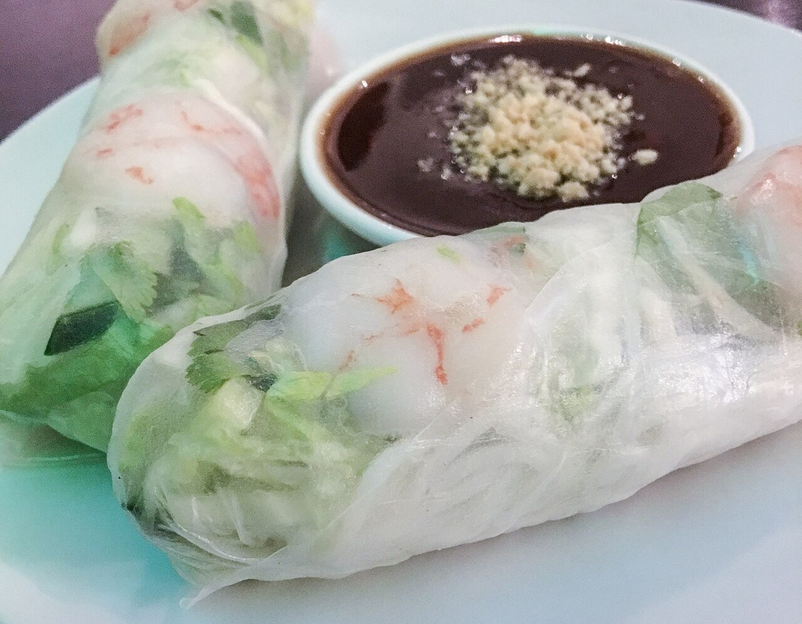

# Salsa hoisin

*Foto: [Alice Wiegand](https://commons.wikimedia.org/wiki/File:Sommerrolle_mit_Hoisin-Sauce_170305_AW.jpg), [CC BY-SA 4.0](https://creativecommons.org/licenses/by-sa/4.0/deed.es), vía Wikimedia Commons.*

Soja, pasta de sésamo o cacahuete, azúcar, vinagre, ajo y cinco especias: una salsa espesa, dulce y salada para el pato laqueado, los rollitos y los salteados. En la foto, rollitos con hoisin para mojar.

🥄 Para **1 tarro pequeño** (unos 150 ml) · ⏱️ 10 minutos · Dificultad: fácil

*In English:* [Hoisin sauce](hoisin.en.md)

## Ingredientes

- 4 cucharadas de salsa de soja
- 2 cucharadas de pasta de sésamo (o crema de cacahuete)
- 2 cucharadas de azúcar moreno (o sirope de agave)
- 1 cucharada de miso rojo o pasta de judías negras
- 2 cucharaditas de vinagre de arroz
- 1 diente de ajo rallado
- 1 cucharadita de aceite de sésamo
- ¼ de cucharadita de cinco especias chinas
- 1-2 cucharadas de agua

## Preparación

1. **Mezclar.** Pon todos los ingredientes menos el agua en un cuenco.
2. **Batir.** Bátelos con unas varillas hasta que la pasta de sésamo se integre y quede una crema lisa.
3. **Calentar.** Para que espese y se ligue mejor, cuécela 2-3 minutos a fuego suave, removiendo.
4. **Ajustar.** Añade agua poco a poco hasta que tenga la textura de una salsa barbacoa espesa.
5. **Guardar.** Déjala enfriar y guárdala en un tarro en la nevera.

## Consejos

- **Pato laqueado:** úntala en las tortitas con pepino y cebolleta.
- **Dura 2 semanas** en la nevera en un tarro cerrado.
- **Más oscura:** añade una cucharadita de melaza.
