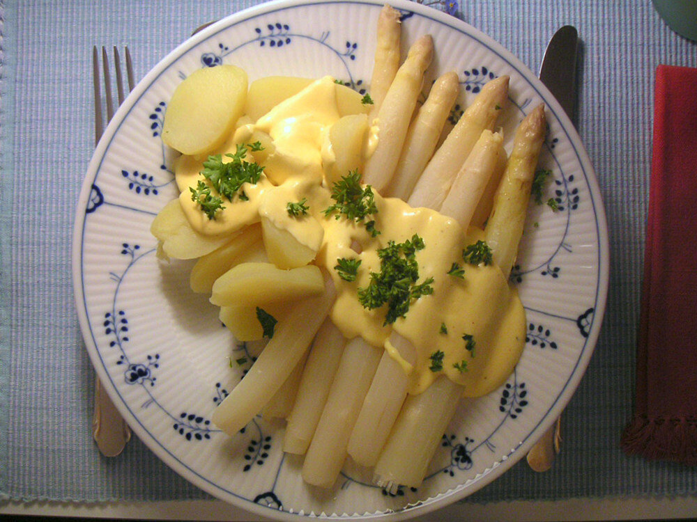

# Hollandaise sauce

*Photo: [Elya](https://commons.wikimedia.org/wiki/File:Spargel_sauce_hollandaise.jpg), [CC BY-SA 3.0](https://creativecommons.org/licenses/by-sa/3.0/), via Wikimedia Commons.*

Egg yolks emulsified with butter and lemon over a water bath: the sauce for asparagus and eggs Benedict.

🥄 Serves **4** · ⏱️ 20 minutes · Difficulty: medium

*En español:* [Salsa holandesa (sauce hollandaise)](hollandaise.es.md)

## Ingredients

- 3 egg yolks
- 14 tablespoons (1¾ sticks) butter
- 1 tablespoon lemon juice
- 1 tablespoon water
- 1 pinch salt
- 1 pinch cayenne or white pepper (optional)

## Directions

1. **Butter.** Melt it and let it cool slightly, skimming off the foam.
2. **Yolks.** In a bowl over barely simmering water, whisk the yolks with the water and lemon until thick and doubled, 3–4 minutes.
3. **Mount.** Off the heat, whisk in the warm butter in a thin stream until thick and glossy.
4. **Finish.** Add salt and cayenne and adjust the lemon. Serve warm.

## Tips

- **Serve with** asparagus, eggs Benedict, salmon, steamed fish or broccoli.
- **Blender method:** put the yolks, lemon and salt in the cup and stream in very hot butter with the blender running.
- **If it breaks:** whisk 1 tablespoon hot water in a clean bowl and slowly whisk in the sauce.
