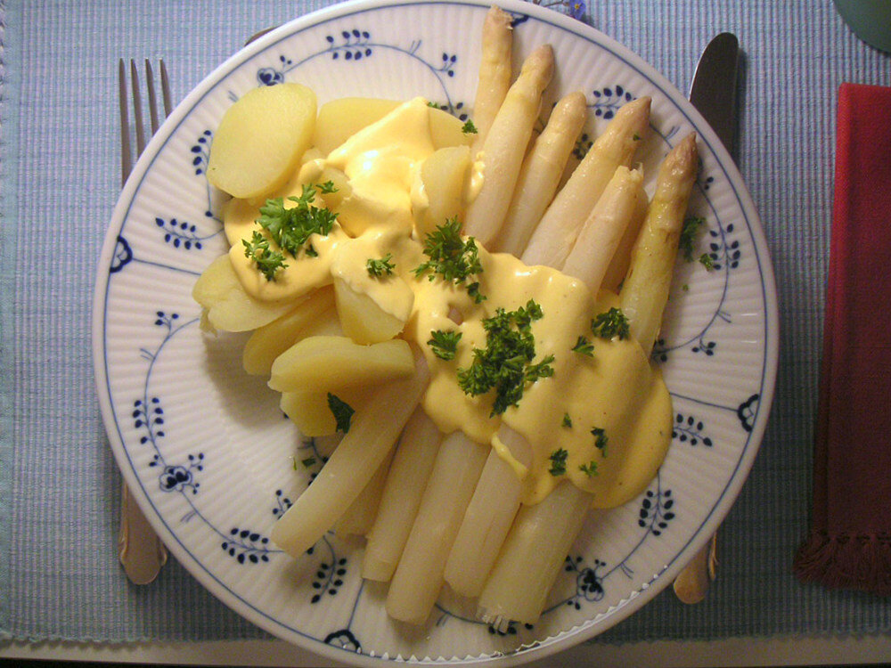

# Salsa holandesa (sauce hollandaise)

*Foto: [Elya](https://commons.wikimedia.org/wiki/File:Spargel_sauce_hollandaise.jpg), [CC BY-SA 3.0](https://creativecommons.org/licenses/by-sa/3.0/deed.es), vía Wikimedia Commons.*

Yemas emulsionadas con mantequilla y limón al baño maría: la salsa de los espárragos y los huevos Benedict.

🥄 Para **4 personas** · ⏱️ 20 minutos · Dificultad: media

*In English:* [Hollandaise sauce](hollandaise.en.md)

## Ingredientes

- 3 yemas de huevo
- 200 g de mantequilla
- 1 cucharada de zumo de limón
- 1 cucharada de agua
- 1 pizca de sal
- 1 pizca de cayena o de pimienta blanca (opcional)

## Preparación

1. **La mantequilla.** Fúndela y déjala templar, retirando la espuma.
2. **Las yemas.** En un bol al baño maría, sin que el agua hierva, bate las yemas con el agua y el limón hasta que espesen y doblen su volumen, 3–4 minutos.
3. **Montar.** Fuera del fuego, añade la mantequilla templada en un hilo fino, batiendo sin parar, hasta que quede espesa y brillante.
4. **Terminar.** Añade la sal y la cayena y ajusta de limón. Sírvela templada.

## Consejos

- **Con** espárragos, huevos Benedict, salmón, pescado al vapor o brócoli.
- **Con batidora:** pon las yemas, el limón y la sal en el vaso y añade la mantequilla muy caliente en un hilo con la batidora en marcha.
- **Si se corta:** bate 1 cucharada de agua caliente en otro bol y añade la salsa poco a poco.
