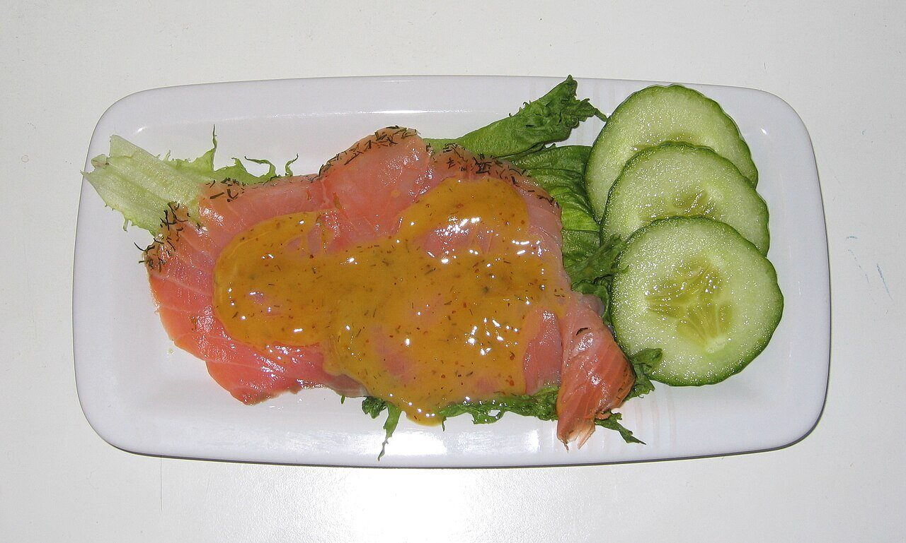

# Hovmästarsås (mustard dill sauce)

*Photo: [Tomas er](https://commons.wikimedia.org/wiki/File:Gravlax_med_hovm%C3%A4stars%C3%A5s.jpg), [CC BY-SA 3.0](https://creativecommons.org/licenses/by-sa/3.0/), via Wikimedia Commons.*

Mustard, sugar, vinegar and oil emulsified with plenty of dill: the sweet and tangy Swedish sauce for gravlax, the cured salmon shown in the photo.

🥄 Serves **4** · ⏱️ 10 minutes · Difficulty: easy

*En español:* [Hovmästarsås (salsa de mostaza y eneldo)](hovmastarsas.es.md)

## Ingredients

- 2 tablespoons Swedish or Dijon mustard
- 1 tablespoon whole-grain mustard
- 1 to 2 tablespoons sugar
- 1 tablespoon white wine vinegar
- 7 tablespoons sunflower oil
- 3 tablespoons chopped fresh dill
- Salt and white pepper

## Directions

1. **Base.** Whisk both mustards with the sugar, vinegar, salt and pepper in a bowl until the sugar dissolves.
2. **Oil.** Whisk in the oil in a thin stream, like mayonnaise, until thick and glossy.
3. **Dill.** Stir in the chopped dill.
4. **Rest.** Chill 30 minutes so the dill flavors the sauce.
5. **Serve.** With gravlax or smoked salmon, boiled potatoes and rye bread.

## Tips

- **Balance:** it should be sweet and tangy at once; adjust with more sugar or vinegar.
- **If it breaks,** whisk a spoonful of mustard in a clean bowl and add the sauce slowly.
- **Creamier:** stir in a spoonful of sour cream at the end.
