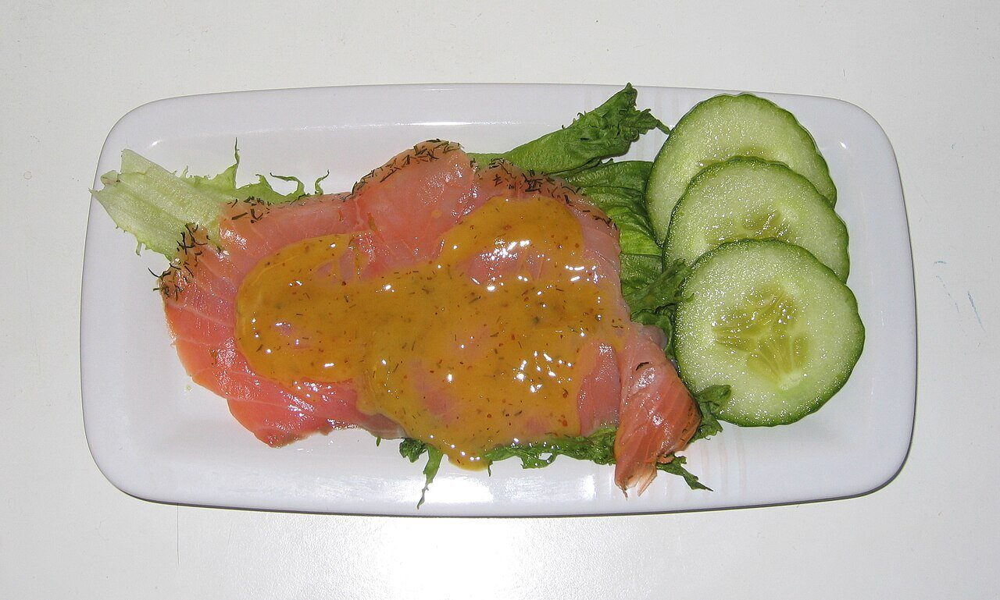

# Hovmästarsås (salsa de mostaza y eneldo)

*Foto: [Tomas er](https://commons.wikimedia.org/wiki/File:Gravlax_med_hovm%C3%A4stars%C3%A5s.jpg), [CC BY-SA 3.0](https://creativecommons.org/licenses/by-sa/3.0/deed.es), vía Wikimedia Commons.*

Mostaza, azúcar, vinagre y aceite emulsionados con mucho eneldo: la salsa sueca agridulce del gravlax, el salmón curado, que aparece en la foto.

🥄 Para **4 personas** · ⏱️ 10 minutos · Dificultad: fácil

*In English:* [Hovmästarsås (mustard dill sauce)](hovmastarsas.en.md)

## Ingredientes

- 2 cucharadas de mostaza sueca o de Dijon
- 1 cucharada de mostaza antigua (en grano)
- 1-2 cucharadas de azúcar
- 1 cucharada de vinagre de vino blanco
- 100 ml de aceite de girasol
- 3 cucharadas de eneldo fresco picado
- Sal y pimienta blanca

## Preparación

1. **La base.** Bate en un cuenco las dos mostazas con el azúcar, el vinagre, la sal y la pimienta, hasta que el azúcar se disuelva.
2. **El aceite.** Añade el aceite en hilo fino, sin dejar de batir, como una mayonesa, hasta que la salsa espese y brille.
3. **El eneldo.** Incorpora el eneldo picado.
4. **Reposar.** Déjala 30 minutos en la nevera para que el eneldo suelte el sabor.
5. **Servir.** Con gravlax o salmón ahumado, patatas cocidas y pan de centeno.

## Consejos

- **Equilibrio:** debe ser dulce y ácida a la vez; ajusta con más azúcar o vinagre.
- **Si se corta,** bate una cucharada de mostaza en otro cuenco y añade la salsa poco a poco.
- **Más cremosa:** añade una cucharada de nata agria al final.
