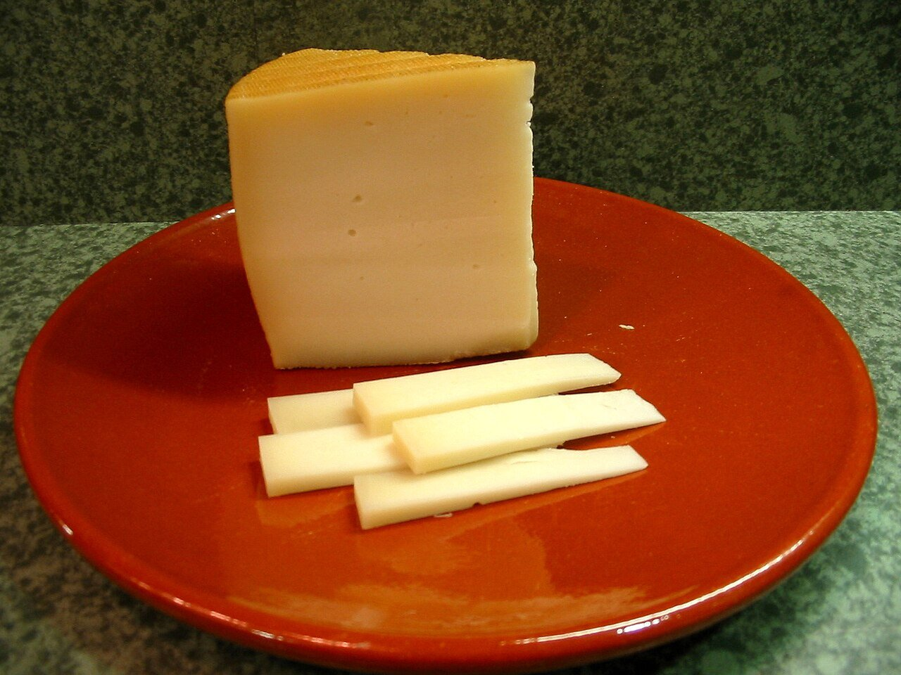

# Idiazábal cheese sauce

*Photo: [Xavigivax](https://commons.wikimedia.org/wiki/File:Queso_Idiaz%C3%A1bal.jpg), [CC BY-SA 3.0](https://creativecommons.org/licenses/by-sa/3.0/), via Wikimedia Commons.*

Smoked Idiazábal cheese melted with cream and shallot: a Basque sauce for meat, potatoes and vegetables. The photo shows the cheese, not the sauce.

🥄 Serves **4** · ⏱️ 15 minutes · Difficulty: easy

*En español:* [Salsa de queso Idiazábal](idiazabal.es.md)

## Ingredients

- 5 oz Idiazábal cheese (smoked is best), grated
- ¾ cup plus 1 tablespoon heavy cream (or whole milk)
- 1 shallot
- 1½ tablespoons butter
- 1 pinch nutmeg
- Salt

## Directions

1. **Shallot.** Gently cook the finely chopped shallot in the butter for 3–4 minutes.
2. **Cream.** Add the cream and heat it without letting it boil hard.
3. **Cheese.** Lower the heat and add the cheese gradually, stirring, until melted and smooth.
4. **Adjust.** Add the nutmeg and taste before salting: the cheese is already salty. Thin with a little milk if too thick.

## Tips

- **Serve with** tenderloin, braised cheeks, roast potatoes, mushrooms, asparagus or roasted peppers.
- **Don't boil it** once the cheese is in, or it will split.
- **No cream:** use milk and thicken with 1 teaspoon flour cooked in the butter.
