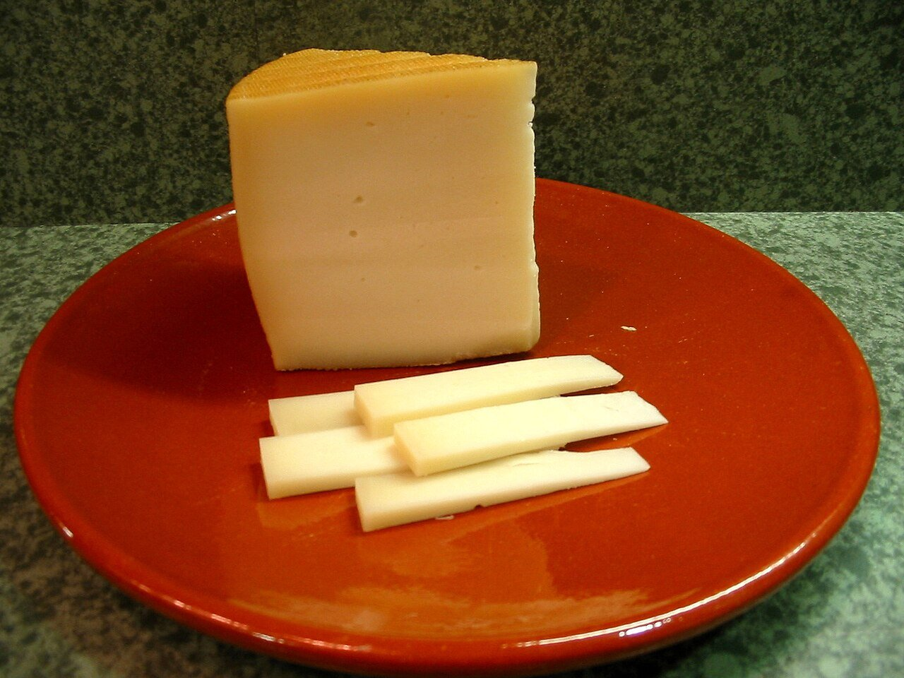

# Salsa de queso Idiazábal

*Foto: [Xavigivax](https://commons.wikimedia.org/wiki/File:Queso_Idiaz%C3%A1bal.jpg), [CC BY-SA 3.0](https://creativecommons.org/licenses/by-sa/3.0/deed.es), vía Wikimedia Commons.*

Queso Idiazábal ahumado fundido con nata y chalota: una salsa vasca para carnes, patatas y verduras. La foto muestra el queso, no la salsa.

🥄 Para **4 personas** · ⏱️ 15 minutos · Dificultad: fácil

*In English:* [Idiazábal cheese sauce](idiazabal.en.md)

## Ingredientes

- 150 g de queso Idiazábal (mejor ahumado), rallado
- 200 ml de nata para cocinar (o leche entera)
- 1 chalota
- 20 g de mantequilla
- 1 pizca de nuez moscada
- Sal

## Preparación

1. **La chalota.** Pocha la chalota muy picada en la mantequilla a fuego suave 3–4 minutos.
2. **La nata.** Añade la nata y caliéntala sin que llegue a hervir con fuerza.
3. **El queso.** Baja el fuego y añade el queso poco a poco, removiendo, hasta que se funda y la salsa quede lisa.
4. **Ajustar.** Añade la nuez moscada y prueba antes de salar: el queso ya es salado. Si espesa demasiado, aclárala con un poco de leche.

## Consejos

- **Con** solomillo, carrilleras, patatas asadas, setas, espárragos o pimientos asados.
- **No la hiervas** después de añadir el queso o se cortará.
- **Sin nata:** usa leche y espesa con 1 cucharadita de harina tostada en la mantequilla.
