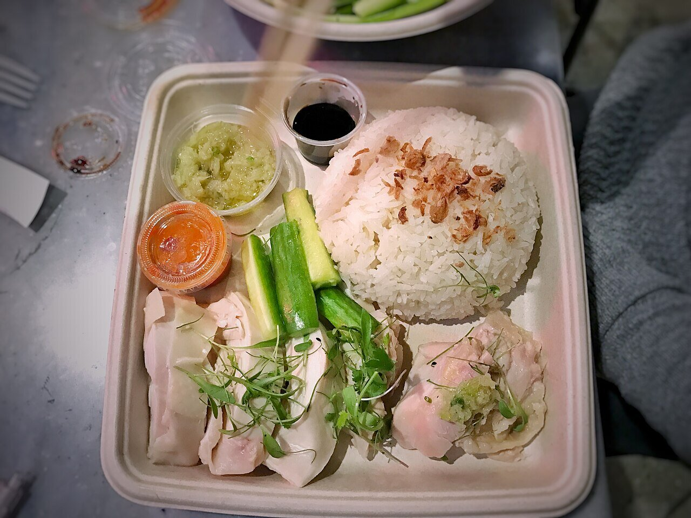

# Ginger scallion sauce

*Photo: [T.Tseng](https://commons.wikimedia.org/wiki/File:Hainan_Chicken,_garlic_rice,_pickles,_ginger_scallion_sauce,_seasoned_soy,_chili_sauce_(31740963840).jpg), [CC BY 2.0](https://creativecommons.org/licenses/by/2.0/), via Wikimedia Commons.*

Finely chopped ginger and scallions scalded with smoking-hot oil and salt: the Cantonese sauce for poached chicken (bai qie ji) and Hainanese chicken rice, shown in the photo.

🥄 Serves **4** · ⏱️ 10 minutes · Difficulty: easy

*En español:* [Salsa de jengibre y cebolleta](jengibre-cebolleta.es.md)

## Ingredients

- 1 bunch scallions (about 3½ oz), green and tender white parts
- 1½ oz fresh ginger
- 1 teaspoon salt
- ½ cup sunflower or peanut oil
- 1 teaspoon soy sauce or rice vinegar (optional)

## Directions

1. **Chop.** Slice the scallions very thin and grate or mince the peeled ginger.
2. **Bowl.** Put them in a heatproof ceramic or metal bowl with the salt.
3. **Oil.** Heat the oil in a small saucepan until it starts to smoke.
4. **Scald.** Pour it all at once over the scallions and ginger; it will sizzle. Stir.
5. **Serve.** Let it cool slightly, add the soy sauce if you like and serve with chicken, steamed fish or noodles.

## Tips

- **Use a big bowl:** the hot oil bubbles up a lot.
- **Better the next day:** the oil soaks up the flavor. Keeps 1 week in the fridge.
- **With noodles:** two spoonfuls over freshly cooked wheat noodles make a meal.
