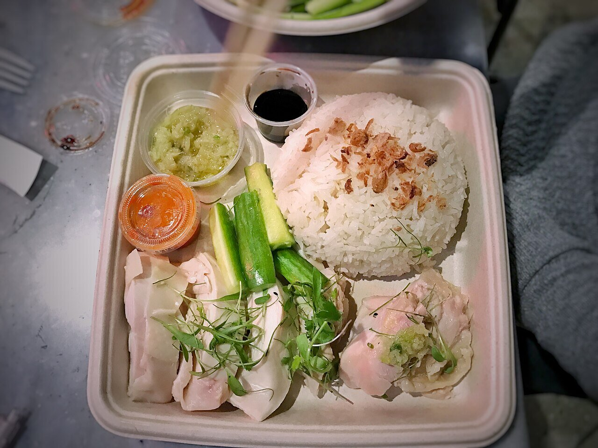

# Salsa de jengibre y cebolleta

*Foto: [T.Tseng](https://commons.wikimedia.org/wiki/File:Hainan_Chicken,_garlic_rice,_pickles,_ginger_scallion_sauce,_seasoned_soy,_chili_sauce_(31740963840).jpg), [CC BY 2.0](https://creativecommons.org/licenses/by/2.0/deed.es), vía Wikimedia Commons.*

Jengibre y cebolleta muy picados, escaldados con aceite humeante y sal: la salsa cantonesa del pollo hervido (bai qie ji) y del arroz con pollo de Hainan, que aparece en la foto.

🥄 Para **4 personas** · ⏱️ 10 minutos · Dificultad: fácil

*In English:* [Ginger scallion sauce](jengibre-cebolleta.en.md)

## Ingredientes

- 1 manojo de cebolletas (unos 100 g), solo la parte verde y blanca tierna
- 40 g de jengibre fresco
- 1 cucharadita de sal
- 120 ml de aceite de girasol o cacahuete
- 1 cucharadita de salsa de soja o de vinagre de arroz (opcional)

## Preparación

1. **Picar.** Pica la cebolleta muy fina y ralla o pica el jengibre pelado.
2. **El cuenco.** Ponlos en un cuenco de cerámica o metal resistente al calor con la sal.
3. **El aceite.** Calienta el aceite en un cazo hasta que empiece a humear.
4. **Escaldar.** Viértelo de golpe sobre la cebolleta y el jengibre; chisporroteará. Remueve.
5. **Servir.** Déjala templar, añade la soja si quieres y sírvela con pollo, pescado al vapor o fideos.

## Consejos

- **Cuenco grande:** el aceite caliente burbujea mucho; deja espacio.
- **Mejor al día siguiente:** el aceite se impregna de sabor. Dura 1 semana en la nevera.
- **Con fideos:** dos cucharadas sobre fideos de trigo recién cocidos son una comida.
