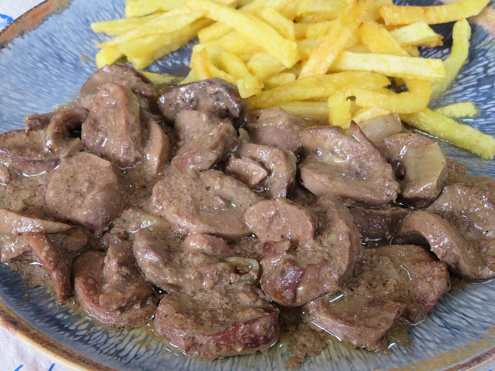

# Sherry sauce

*Photo: [Juan Emilio Prades Bel](https://commons.wikimedia.org/wiki/File:Ri%C3%B1ones_al_Jerez_(Espa%C3%B1a).jpg), [CC BY-SA 4.0](https://creativecommons.org/licenses/by-sa/4.0/), via Wikimedia Commons.*

Onion, garlic, fino or oloroso sherry and stock: the sauce for Spanish kidneys in sherry, also great with chicken, pork or mushrooms.

🥄 Serves **4** · ⏱️ 25 minutes · Difficulty: easy

*En español:* [Salsa al jerez](jerez.es.md)

## Ingredients

- 1 onion
- 2 garlic cloves
- 1 tablespoon all-purpose flour
- ⅔ cup fino sherry (or oloroso, for a richer sauce)
- ¾ cup plus 1 tablespoon beef or chicken stock
- 1 bay leaf
- 1 tablespoon chopped parsley
- 4 tablespoons olive oil
- Salt and pepper

## Directions

1. **Base.** Gently cook the finely chopped onion and garlic in the oil for about 10 minutes.
2. **Flour.** Stir in the flour for 1 minute.
3. **Sherry.** Pour in the sherry, raise the heat and let the alcohol cook off for 2–3 minutes.
4. **Stock.** Add the stock and bay leaf and simmer 8–10 minutes, until the sauce coats a spoon.
5. **Finish.** Remove the bay leaf, add the parsley and season with salt and pepper.

## Tips

- **Kidneys in sherry:** trim 1¼ lb lamb or veal kidneys, soak them 30 minutes in water with vinegar, sear over high heat for 2 minutes and finish 2–3 minutes in the sauce. Overcooked kidneys turn tough.
- **Serve with** shoestring fries, the way Spanish bars do.
- **Fino or oloroso:** fino makes a lighter, drier sauce; oloroso a rounder, nuttier one.
