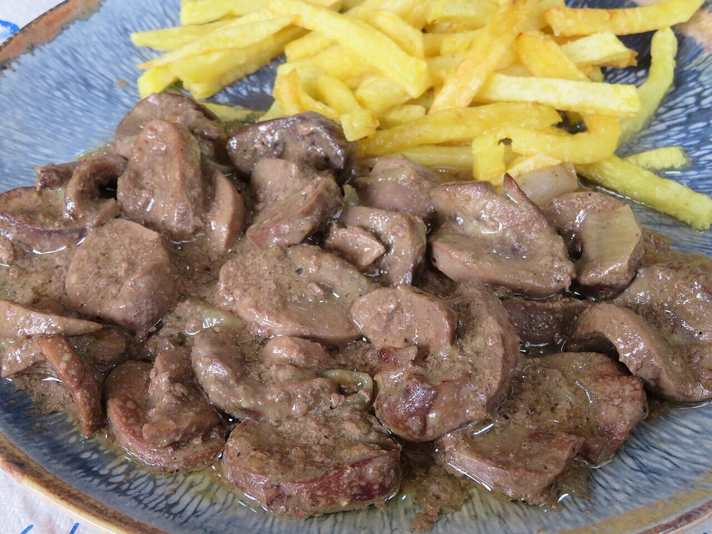

# Salsa al jerez

*Foto: [Juan Emilio Prades Bel](https://commons.wikimedia.org/wiki/File:Ri%C3%B1ones_al_Jerez_(Espa%C3%B1a).jpg), [CC BY-SA 4.0](https://creativecommons.org/licenses/by-sa/4.0/deed.es), vía Wikimedia Commons.*

Cebolla, ajo, vino fino u oloroso y caldo: la salsa de los riñones al jerez, que también va muy bien con pollo, cerdo o setas.

🥄 Para **4 personas** · ⏱️ 25 minutos · Dificultad: fácil

*In English:* [Sherry sauce](jerez.en.md)

## Ingredientes

- 1 cebolla
- 2 dientes de ajo
- 1 cucharada de harina
- 150 ml de vino de Jerez fino (o oloroso, para una salsa más intensa)
- 200 ml de caldo de carne o de pollo
- 1 hoja de laurel
- 1 cucharada de perejil picado
- 4 cucharadas de aceite de oliva
- Sal y pimienta

## Preparación

1. **El sofrito.** Pocha la cebolla y el ajo muy picados en el aceite a fuego suave unos 10 minutos.
2. **La harina.** Añade la harina y remueve 1 minuto.
3. **El jerez.** Moja con el vino, sube el fuego y deja que se evapore el alcohol 2–3 minutos.
4. **El caldo.** Añade el caldo y el laurel y cuece 8–10 minutos, hasta que la salsa napee la cuchara.
5. **Terminar.** Retira el laurel, añade el perejil y ajusta de sal y pimienta.

## Consejos

- **Riñones al jerez:** limpia 600 g de riñones de cordero o de ternera, remójalos en agua con vinagre 30 minutos, saltéalos a fuego vivo 2 minutos y termínalos 2–3 minutos en la salsa. Si se cuecen de más, se endurecen.
- **Con patatas fritas** en bastón, como en los bares.
- **Fino o oloroso:** el fino da una salsa más ligera y seca; el oloroso, más redonda y tostada.
