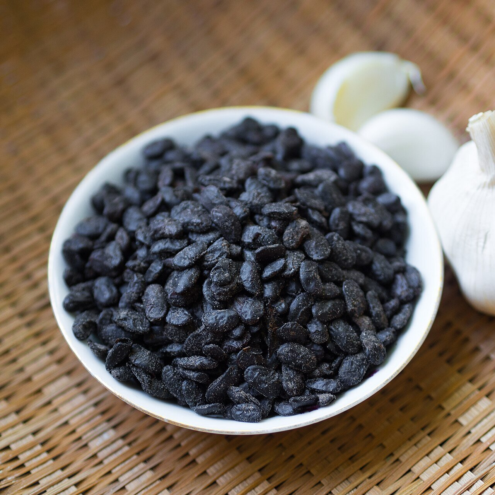

# Black bean sauce

*Photo: [Takeaway](https://commons.wikimedia.org/wiki/File:2015_1012_Preserved_black_beans_douchi_close-up.jpg), [CC BY-SA 4.0](https://creativecommons.org/licenses/by-sa/4.0/), via Wikimedia Commons.*

Fermented black beans (douchi) with garlic, ginger and soy sauce: a deep, savory sauce for steamed spareribs, clams, fish and beef with peppers. The photo shows the fermented black beans.

🥄 Serves **4** · ⏱️ 15 minutes · Difficulty: easy

*En español:* [Salsa de judías negras](judias-negras.es.md)

## Ingredients

- 3 tablespoons fermented black beans (douchi)
- 3 garlic cloves, minced
- ¾-inch piece ginger, minced
- 2 scallions, chopped
- 1 tablespoon soy sauce
- 1 teaspoon sugar
- ⅔ cup broth or water
- 1 teaspoon cornstarch mixed with 1 tablespoon water
- 2 tablespoons oil

## Directions

1. **Beans.** Rinse them for 10 seconds to remove excess salt, drain and mash them lightly with a fork.
2. **Aromatics.** Heat the oil in a wok and stir-fry the garlic, ginger and scallion whites for 30 seconds.
3. **Beans.** Add the beans and stir-fry 30 seconds more, until fragrant.
4. **Liquid.** Add the soy sauce, sugar and broth and boil for 2 minutes.
5. **Thicken.** Stir in the cornstarch slurry and finish with the scallion greens. Toss with stir-fried meat, seafood or tofu.

## Tips

- **Cantonese style** adds a splash of Shaoxing wine with the broth (then it is not alcohol-free).
- **No heat:** this recipe has no chile; add one to the aromatics if you like.
- **Watch the salt:** douchi is very salty; taste before adding more soy sauce.
