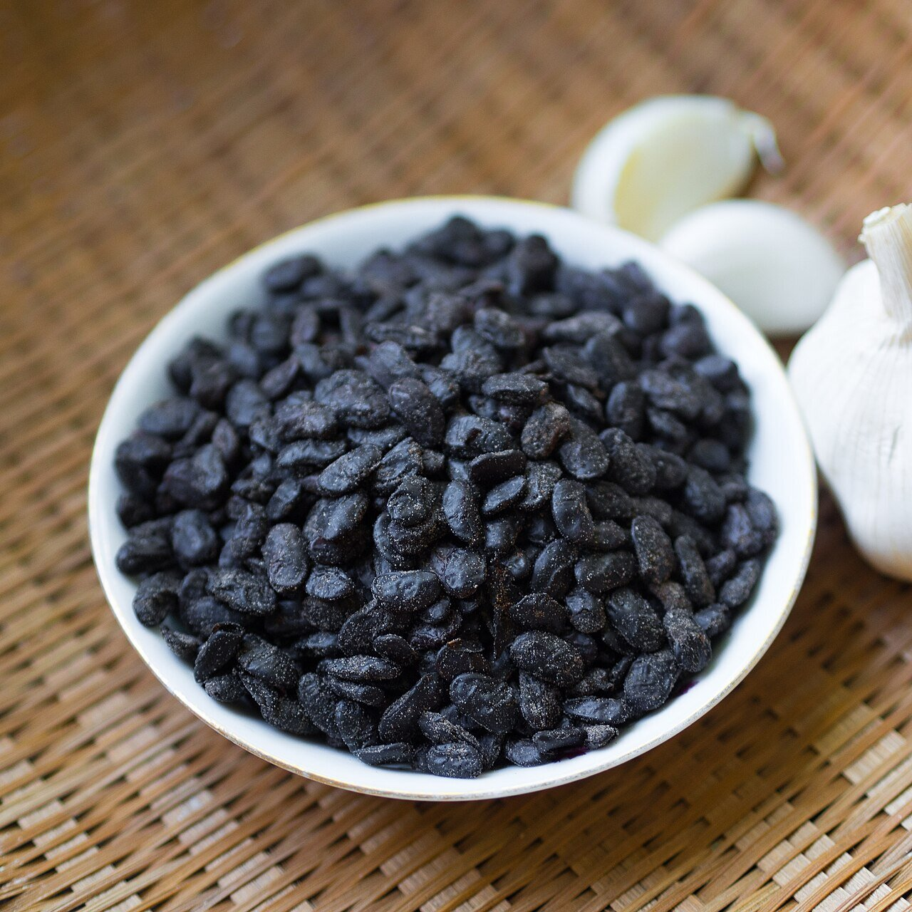

# Salsa de judías negras

*Foto: [Takeaway](https://commons.wikimedia.org/wiki/File:2015_1012_Preserved_black_beans_douchi_close-up.jpg), [CC BY-SA 4.0](https://creativecommons.org/licenses/by-sa/4.0/deed.es), vía Wikimedia Commons.*

Judías negras fermentadas (douchi) con ajo, jengibre y soja: una salsa salada y profunda para costillas al vapor, almejas, pescado y ternera con pimiento. La foto muestra las judías negras fermentadas.

🥄 Para **4 personas** · ⏱️ 15 minutos · Dificultad: fácil

*In English:* [Black bean sauce](judias-negras.en.md)

## Ingredientes

- 3 cucharadas de judías negras fermentadas (douchi)
- 3 dientes de ajo picados
- 1 trozo de jengibre de 2 cm, picado
- 2 cebolletas picadas
- 1 cucharada de salsa de soja
- 1 cucharadita de azúcar
- 150 ml de caldo o agua
- 1 cucharadita de maicena disuelta en 1 cucharada de agua
- 2 cucharadas de aceite

## Preparación

1. **Las judías.** Acláralas 10 segundos para quitarles el exceso de sal, escúrrelas y aplástalas un poco con un tenedor.
2. **El sofrito.** Calienta el aceite en el wok y saltea el ajo, el jengibre y la parte blanca de la cebolleta 30 segundos.
3. **Las judías.** Añade las judías y saltea 30 segundos más, hasta que huelan.
4. **El líquido.** Añade la soja, el azúcar y el caldo y deja hervir 2 minutos.
5. **Espesar.** Liga con la maicena y termina con la parte verde de la cebolleta. Mézclala con la carne, el marisco o el tofu salteados.

## Consejos

- **Al estilo cantonés** se añade un chorrito de vino de Shaoxing con el caldo (ya no sería sin alcohol).
- **Sin picante:** la receta no lleva guindilla; si te gusta, añade una al sofrito.
- **Atención a la sal:** el douchi es muy salado; prueba antes de añadir más soja.
