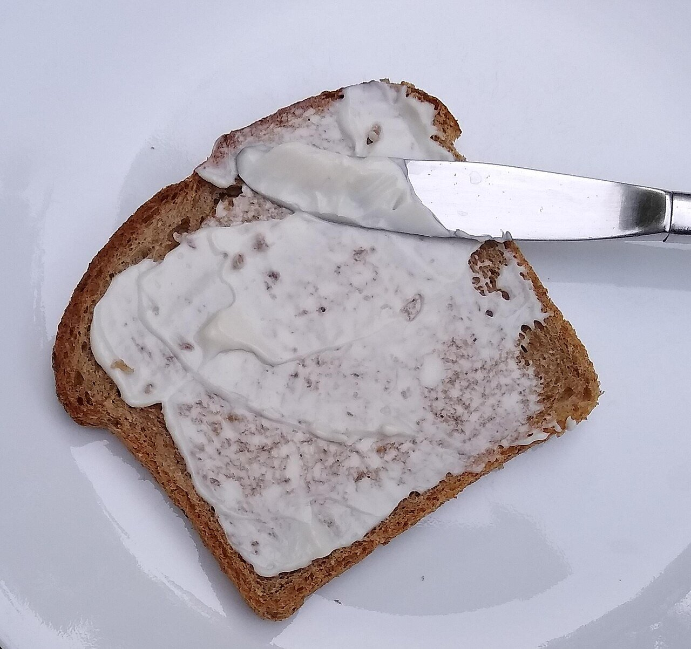

# Vegan soy milk mayonnaise

*Photo: [Mx. Granger](https://commons.wikimedia.org/wiki/File:Vegan_mayonnaise_on_bread.jpg), [CC0](https://creativecommons.org/publicdomain/zero/1.0/), via Wikimedia Commons.*

Egg-free mayonnaise emulsified with soy milk: vegan, with no alcohol and no peppers.

🥄 Makes **about 1¼ cups** · ⏱️ 5 minutes · Difficulty: easy

*En español:* [Lactonesa (mahonesa vegana)](lactonesa.es.md)

## Ingredients

- Scant ½ cup unsweetened soy milk, well chilled
- ¾ cup plus 1 tablespoon sunflower oil (or half mild olive oil)
- 1 tablespoon lemon juice or apple cider vinegar
- 1 garlic clove (optional, for a vegan aioli)
- Salt

## Directions

1. **Into the cup.** Put the soy milk, lemon juice, salt and garlic, if using, in the immersion blender cup.
2. **Emulsify.** With the blender running at the bottom, pour in the oil in a thin stream.
3. **Lift.** Once it starts to thicken, move the blender up and down until all the oil is incorporated.
4. **Taste.** Adjust salt and lemon. If it's runny, blend in a little more oil.

## Tips

- **It must be soy milk:** oat or almond milk emulsify poorly.
- **Keeps** 4–5 days in the fridge.
- **A base** for vegan Spanish potato salad or vegan cocktail sauce.
