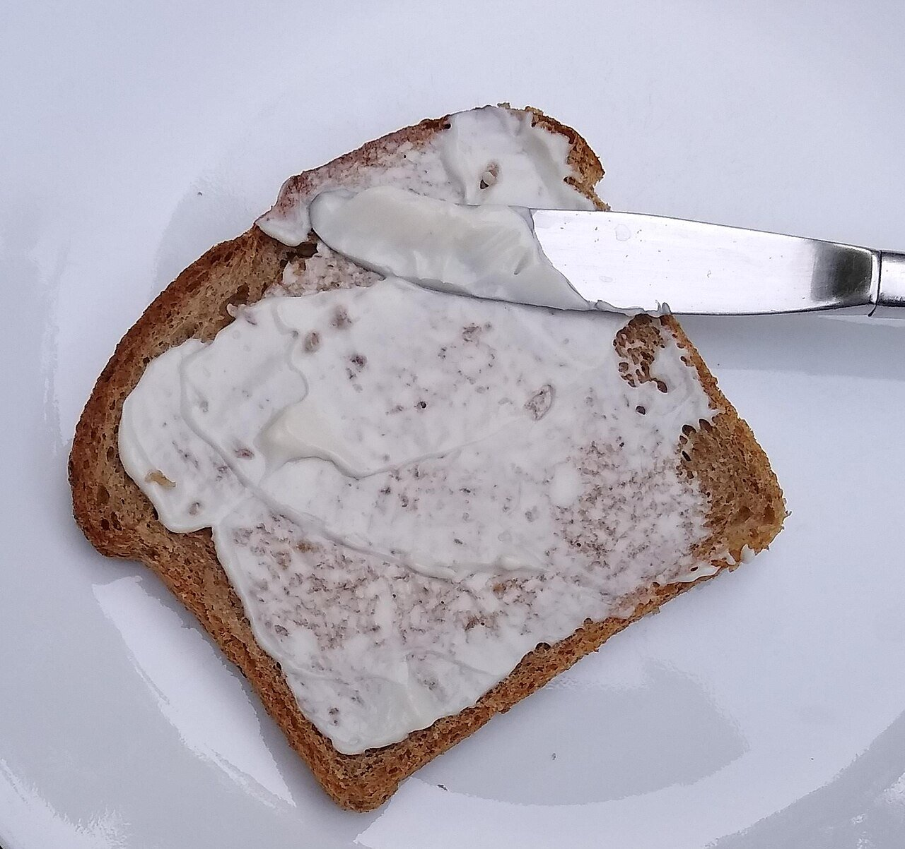

# Lactonesa (mahonesa vegana)

*Foto: [Mx. Granger](https://commons.wikimedia.org/wiki/File:Vegan_mayonnaise_on_bread.jpg), [CC0](https://creativecommons.org/publicdomain/zero/1.0/deed.es), vía Wikimedia Commons.*

Mahonesa sin huevo, ligada con bebida de soja: vegana, sin alcohol y sin pimiento.

🥄 Para **unos 300 ml** · ⏱️ 5 minutos · Dificultad: fácil

*In English:* [Vegan soy milk mayonnaise](lactonesa.en.md)

## Ingredientes

- 100 ml de bebida de soja sin azúcar, bien fría
- 200 ml de aceite de girasol (o mitad de oliva suave)
- 1 cucharada de zumo de limón o de vinagre de manzana
- 1 diente de ajo (opcional, para un alioli vegano)
- Sal

## Preparación

1. **Al vaso.** Pon la bebida de soja, el limón, la sal y el ajo, si lo usas, en el vaso de la batidora.
2. **Emulsionar.** Con la batidora en marcha en el fondo, añade el aceite en un hilo fino.
3. **Subir.** Cuando empiece a espesar, sube y baja la batidora hasta que todo el aceite esté integrado.
4. **Probar.** Ajusta de sal y limón. Si queda líquida, añade un poco más de aceite batiendo.

## Consejos

- **Tiene que ser de soja:** las bebidas de avena o de almendra emulsionan peor.
- **Aguanta** 4–5 días en la nevera.
- **Base** para una ensaladilla vegana o una salsa rosa vegana.
