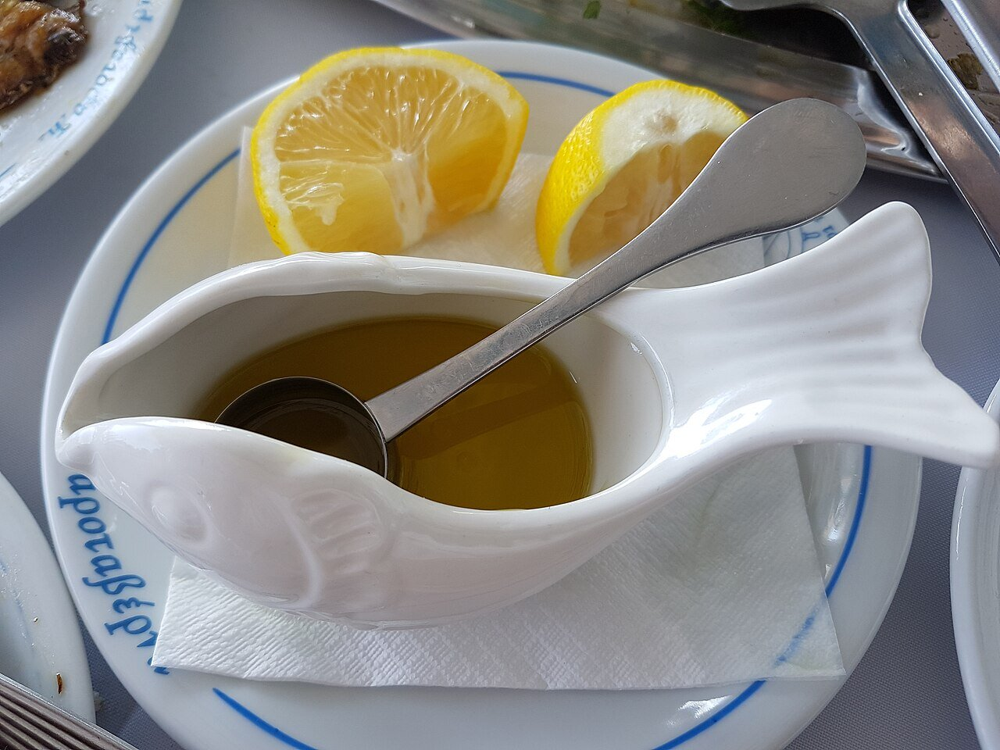

# Ladolemono

*Photo: [FocalPoint](https://commons.wikimedia.org/wiki/File:Ladolemono_for_the_fish.jpg), [CC BY-SA 4.0](https://creativecommons.org/licenses/by-sa/4.0/), via Wikimedia Commons.*

Olive oil, lemon and oregano shaken until creamy: the Greek sauce for grilled fish and octopus, lamb chops and vegetables.

🥄 Serves **4** · ⏱️ 5 minutes · Difficulty: easy

*En español:* [Ladolémono](ladolemono.es.md)

## Ingredients

- 7 tablespoons extra-virgin olive oil
- 3½ tablespoons lemon juice
- 1 teaspoon dried oregano
- 1 garlic clove, crushed (optional)
- 1 teaspoon mustard (optional, helps it emulsify)
- Salt and black pepper

## Directions

1. **Base.** Put the lemon juice, salt, oregano and, if using, the garlic and mustard in a jar.
2. **Oil.** Add the olive oil.
3. **Emulsify.** Close the jar and shake hard for 30 seconds, until cloudy and slightly thick.
4. **Serve.** Pour it over freshly cooked fish or meat, or brush it on while grilling.

## Tips

- **Ratio:** two parts oil to one part lemon; adjust to taste.
- **Shake before serving:** it separates as it sits.
- **Variation:** a little chopped parsley is great with fish.
