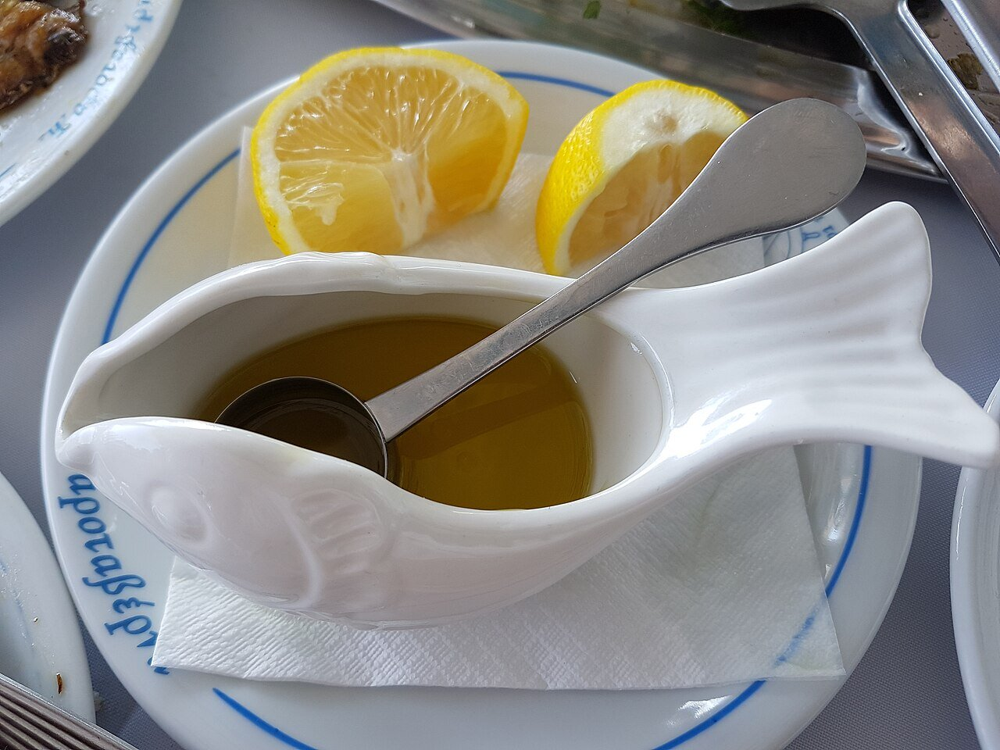

# Ladolémono

*Foto: [FocalPoint](https://commons.wikimedia.org/wiki/File:Ladolemono_for_the_fish.jpg), [CC BY-SA 4.0](https://creativecommons.org/licenses/by-sa/4.0/deed.es), vía Wikimedia Commons.*

Aceite de oliva, limón y orégano batidos hasta emulsionar: la salsa griega para el pescado y el pulpo a la brasa, las chuletas y las verduras.

🥄 Para **4 personas** · ⏱️ 5 minutos · Dificultad: fácil

*In English:* [Ladolemono](ladolemono.en.md)

## Ingredientes

- 100 ml de aceite de oliva virgen extra
- 50 ml de zumo de limón
- 1 cucharadita de orégano seco
- 1 diente de ajo machacado (opcional)
- 1 cucharadita de mostaza (opcional, para que emulsione mejor)
- Sal y pimienta negra

## Preparación

1. **La base.** Pon en un tarro el zumo de limón, la sal, el orégano y, si los usas, el ajo y la mostaza.
2. **El aceite.** Añade el aceite de oliva.
3. **Emulsionar.** Cierra el tarro y agítalo con fuerza 30 segundos, hasta que la salsa quede turbia y algo espesa.
4. **Servir.** Échala por encima del pescado o la carne recién hechos, o úsala para pincelar mientras se asan.

## Consejos

- **Proporción:** dos partes de aceite por una de limón; ajusta al gusto.
- **Agita antes de servir:** se separa al reposar.
- **Variante:** con un poco de perejil picado queda ideal para el pescado.
