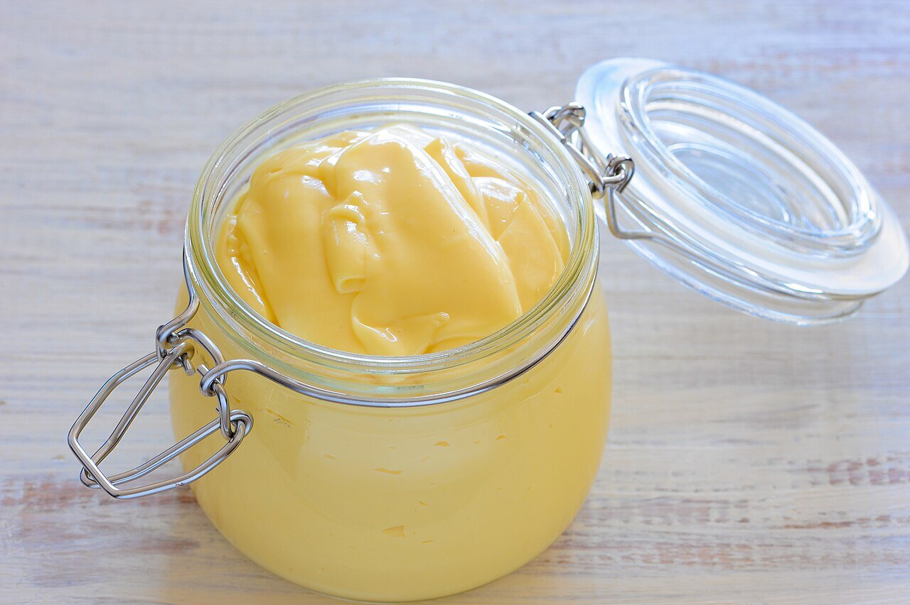

# Spanish mayonnaise

*Photo: [jules](https://commons.wikimedia.org/wiki/File:Mayonnaise_(1).jpg), [CC BY 2.0](https://creativecommons.org/licenses/by/2.0/), via Wikimedia Commons.*

The sauce from Mahón, on Menorca: egg, oil, lemon and salt, emulsified.

🥄 Makes **about 1 cup** · ⏱️ 5 minutes · Difficulty: easy

*En español:* [Mahonesa](mahonesa.es.md)

## Ingredients

- 1 egg, at room temperature
- ¾ cup plus 1 tablespoon mild olive oil (or half sunflower oil)
- 1 tablespoon lemon juice or vinegar
- Salt

## Directions

1. **Into the cup.** Put the egg, lemon juice and salt in the immersion blender cup and pour the oil on top.
2. **Emulsify.** Push the blender to the bottom and run it without moving until the sauce turns pale.
3. **Lift slowly.** Raise the blender little by little until all the oil is incorporated.
4. **Taste.** Adjust salt and lemon.

## Tips

- **Food safety:** refrigerate and use within 24 hours. Pasteurized eggs are safer.
- **If it breaks:** put a fresh egg in a clean cup and slowly blend in the broken sauce.
- **The base** for Spanish potato salad and many cold sauces.
