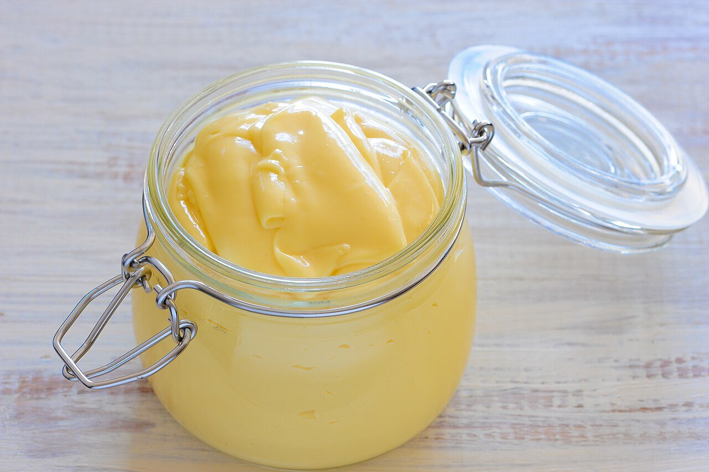

# Mahonesa

*Foto: [jules](https://commons.wikimedia.org/wiki/File:Mayonnaise_(1).jpg), [CC BY 2.0](https://creativecommons.org/licenses/by/2.0/deed.es), vía Wikimedia Commons.*

La salsa de Mahón (Menorca): huevo, aceite, limón y sal, ligados en una emulsión.

🥄 Para **unos 250 ml** · ⏱️ 5 minutos · Dificultad: fácil

*In English:* [Spanish mayonnaise](mahonesa.en.md)

## Ingredientes

- 1 huevo a temperatura ambiente
- 200 ml de aceite de oliva suave (o mitad de girasol)
- 1 cucharada de zumo de limón o de vinagre
- Sal

## Preparación

1. **Todo al vaso.** Pon en el vaso de la batidora el huevo, el limón, la sal y, encima, el aceite.
2. **Emulsionar.** Mete la batidora hasta el fondo y enciéndela sin moverla hasta que la salsa empiece a blanquear.
3. **Subir.** Ve subiendo la batidora poco a poco hasta que todo el aceite esté integrado.
4. **Probar.** Ajusta de sal y limón.

## Consejos

- **Seguridad:** guárdala en la nevera y gástala en 24 horas. Con huevo pasteurizado es más segura.
- **Si se corta:** pon otro huevo en un vaso limpio y añade la salsa cortada poco a poco batiendo.
- **Base** de la ensaladilla rusa y de muchas salsas frías.
