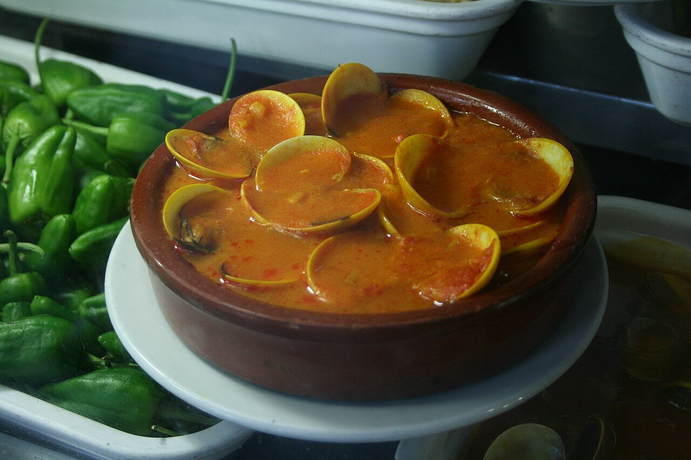

# Spanish seafood sauce

*Photo: [Tamorlan](https://commons.wikimedia.org/wiki/File:Almejas_a_la_marinera-2009.jpg), [CC BY 3.0](https://creativecommons.org/licenses/by/3.0/), via Wikimedia Commons.*

The sauce for Spanish clams a la marinera: onion and garlic base, paprika, white wine and the shellfish juices.

🥄 Serves **4** · ⏱️ 30 minutes (plus soaking) · Difficulty: easy

*En español:* [Salsa marinera](marinera.es.md)

## Ingredients

- 2 lb clams
- 1 onion
- 3 garlic cloves
- 1 small dried chile (optional)
- 1 tablespoon all-purpose flour
- 1 teaspoon sweet Spanish paprika
- ⅔ cup dry white wine
- ⅔ cup fish stock
- Chopped parsley
- 4 tablespoons olive oil
- Salt

## Directions

1. **Purge.** Soak the clams 1–2 hours in cold salted water so they release their sand.
2. **Base.** Gently cook the chopped onion and garlic with the chile for about 10 minutes.
3. **Thicken.** Stir in the flour and paprika for 1 minute, then pour in the wine and let the alcohol cook off.
4. **Clams.** Add the stock and clams, cover and cook over high heat until they open, 3–4 minutes, shaking the pan.
5. **Serve.** Sprinkle with parsley and serve right away. Discard any clams that don't open.

## Tips

- **Serve with bread** to dip in the sauce.
- **Works the same** for mussels, cockles or hake.
- **Don't overcook** the clams or they'll turn rubbery.
