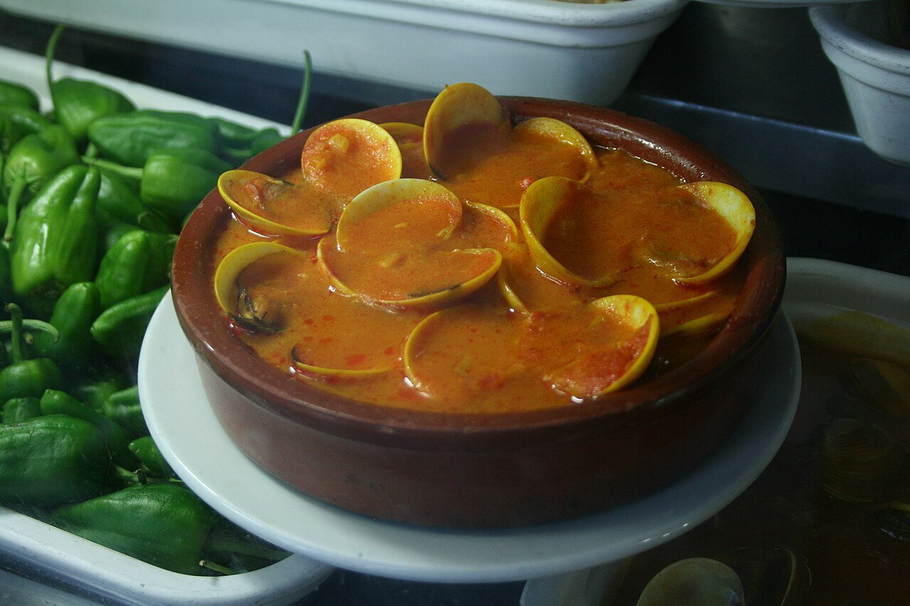

# Salsa marinera

*Foto: [Tamorlan](https://commons.wikimedia.org/wiki/File:Almejas_a_la_marinera-2009.jpg), [CC BY 3.0](https://creativecommons.org/licenses/by/3.0/deed.es), vía Wikimedia Commons.*

La salsa de las almejas a la marinera: sofrito de cebolla y ajo, pimentón, vino blanco y el jugo del marisco.

🥄 Para **4 personas** · ⏱️ 30 minutos (más la purga) · Dificultad: fácil

*In English:* [Spanish seafood sauce](marinera.en.md)

## Ingredientes

- 1 kg de almejas
- 1 cebolla
- 3 dientes de ajo
- 1 guindilla (opcional)
- 1 cucharada de harina
- 1 cucharadita de pimentón dulce
- 150 ml de vino blanco
- 150 ml de fumet de pescado
- Perejil picado
- 4 cucharadas de aceite de oliva
- Sal

## Preparación

1. **Purgar.** Deja las almejas 1–2 horas en agua fría con sal para que suelten la arena.
2. **El sofrito.** Pocha la cebolla y el ajo picados con la guindilla a fuego suave, unos 10 minutos.
3. **Ligar.** Añade la harina y el pimentón, remueve 1 minuto y moja con el vino. Deja que se evapore el alcohol.
4. **Las almejas.** Añade el fumet y las almejas, tapa y cuece a fuego vivo hasta que se abran, 3–4 minutos, moviendo la cazuela.
5. **Servir.** Espolvorea perejil y sirve enseguida. Desecha las almejas que no se abran.

## Consejos

- **Con pan** para mojar en la salsa.
- **Sirve igual** para mejillones, berberechos o merluza a la marinera.
- **No las cuezas de más** o quedarán gomosas.
