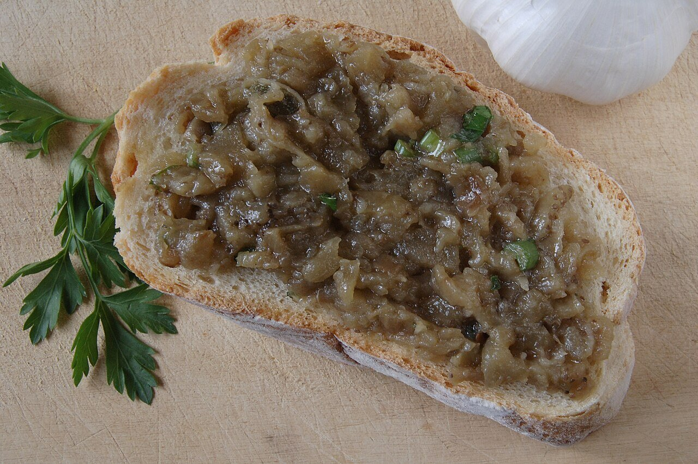

# Melitzanosalata

*Foto: [Badseed](https://commons.wikimedia.org/wiki/File:Eggplant_salad.JPG), [CC BY-SA 3.0](https://creativecommons.org/licenses/by-sa/3.0/deed.es), vía Wikimedia Commons.*

Berenjena asada hasta que sabe a humo, machacada con ajo, aceite de oliva, limón y perejil: el paté griego de berenjena para mojar pan de pita.

🥄 Para **4 personas** · ⏱️ 50 minutos · Dificultad: fácil

*In English:* [Melitzanosalata](melitzanosalata.en.md)

## Ingredientes

- 2 berenjenas grandes (unos 800 g)
- 1 diente de ajo
- 60 ml de aceite de oliva virgen extra
- 1 cucharada de zumo de limón o de vinagre de vino
- 2 cucharadas de perejil picado
- ½ cebolla roja pequeña, muy picada (opcional)
- Sal

## Preparación

1. **Asar.** Pincha las berenjenas y ásalas enteras a 220 °C 40 minutos, o sobre la llama del fuego, dándoles la vuelta, hasta que la piel esté negra y la carne muy blanda.
2. **Escurrir.** Ábrelas, saca la carne con una cuchara y déjala escurrir en un colador 10 minutos para quitarle el agua amarga.
3. **Machacar.** Pícala con un cuchillo o aplástala con un tenedor; mejor con algo de textura que hecha puré.
4. **Aliñar.** Añade el ajo rallado, la sal y el limón, y luego el aceite poco a poco, mezclando.
5. **Terminar.** Incorpora el perejil y la cebolla, si la usas. Sírvela fría con pan de pita.

## Consejos

- **El humo es la clave:** asarla sobre la llama o en la brasa le da el sabor típico.
- **Sin batidora:** se hace a mano; la batidora la deja pastosa.
- **Variante:** algunas casas añaden nueces picadas o un poco de feta desmigada (ya no sería vegana).
