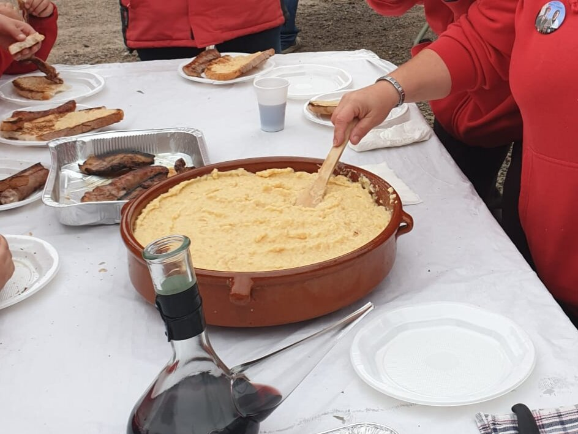

# Quince and garlic aioli

*Photo: [Quimpuig12](https://commons.wikimedia.org/wiki/File:Allioli_de_codony.jpg), [CC BY-SA 4.0](https://creativecommons.org/licenses/by-sa/4.0/), via Wikimedia Commons.*

Roasted quince, garlic and olive oil emulsified in a mortar, with no egg: a Catalan autumn sauce that is vegan, with no alcohol and no peppers.

🥄 Serves **6** · ⏱️ 45 minutes · Difficulty: medium

*En español:* [Alioli de membrillo (allioli de codony)](membrillo.es.md)

## Ingredients

- 2 ripe quinces
- 2–3 garlic cloves
- ⅔ cup mild olive oil
- A few drops lemon juice
- Salt

## Directions

1. **Quince.** Roast it whole at 350 °F for about 40 minutes (or simmer it in water 25 minutes) until very tender. Peel and core it.
2. **Pound.** In a mortar, crush the garlic with the salt into a paste.
3. **Purée.** Add the still-warm quince flesh and pound it with the garlic until smooth.
4. **Emulsify.** Add the oil gradually, always stirring in the same direction, until thick. Finish with a few drops of lemon.

## Tips

- **Serve with** grilled vegetables and mushrooms, roast potatoes or seared tofu.
- **Apple works too** (allioli de poma), made the same way.
- **A blender** is faster and smoother.
