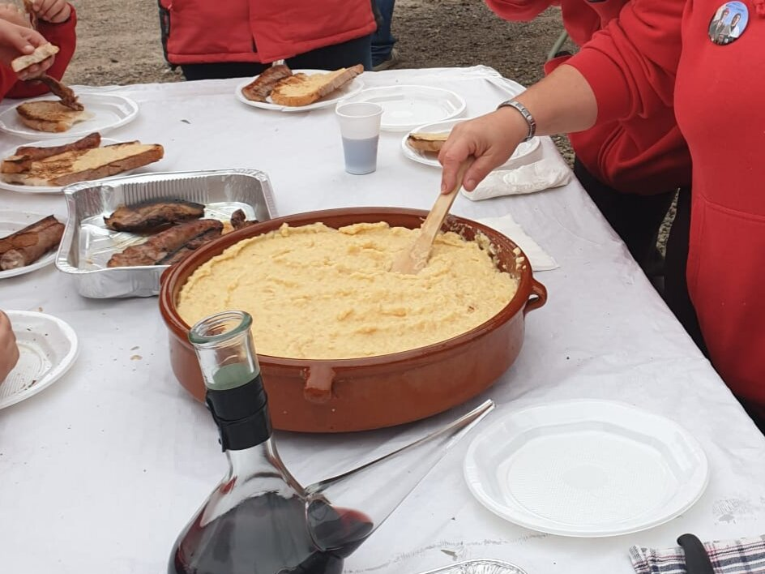

# Alioli de membrillo (allioli de codony)

*Foto: [Quimpuig12](https://commons.wikimedia.org/wiki/File:Allioli_de_codony.jpg), [CC BY-SA 4.0](https://creativecommons.org/licenses/by-sa/4.0/deed.es), vía Wikimedia Commons.*

Membrillo asado, ajo y aceite de oliva ligados en el mortero, sin huevo: una salsa catalana de otoño, vegana, sin alcohol y sin pimiento.

🥄 Para **6 personas** · ⏱️ 45 minutos · Dificultad: media

*In English:* [Quince and garlic aioli](membrillo.en.md)

## Ingredientes

- 2 membrillos maduros
- 2–3 dientes de ajo
- 150 ml de aceite de oliva suave
- Unas gotas de zumo de limón
- Sal

## Preparación

1. **El membrillo.** Ásalo entero en el horno a 180 °C unos 40 minutos (o cuécelo en agua 25 minutos), hasta que esté muy tierno. Pélalo y quítale el corazón.
2. **Machacar.** En el mortero, machaca los ajos con la sal hasta hacer una pasta.
3. **El puré.** Añade la pulpa de membrillo, todavía templada, y machácala con el ajo hasta que quede fina.
4. **Ligar.** Añade el aceite poco a poco, removiendo siempre en el mismo sentido, hasta tener una salsa espesa. Termina con unas gotas de limón.

## Consejos

- **Con** verduras y setas a la brasa, patatas asadas o tofu a la plancha.
- **Con manzana** también se hace (allioli de poma), igual que con membrillo.
- **Con batidora** sale más rápido y más fino.
