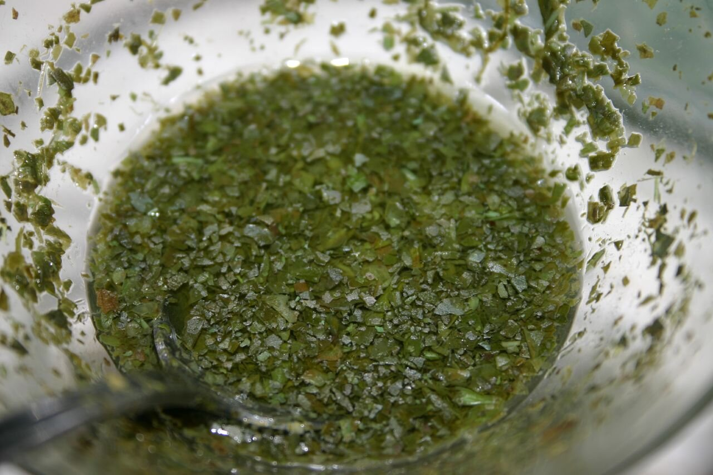

# Mint sauce

*Photo: [rjp](https://commons.wikimedia.org/wiki/File:Mint_Sauce.jpg), [CC BY-SA 2.0](https://creativecommons.org/licenses/by-sa/2.0/), via Wikimedia Commons.*

Fresh mint chopped with sugar, boiling water and malt vinegar: the English sauce for Sunday roast lamb.

🥄 Serves **4** · ⏱️ 10 minutes + 30 resting · Difficulty: easy

*En español:* [Mint sauce (salsa inglesa de menta)](mint-sauce.es.md)

## Ingredients

- 1 large bunch fresh mint (about 1 oz leaves)
- 1 tablespoon sugar
- Pinch of salt
- 3 tablespoons boiling water
- 3 to 4 tablespoons malt vinegar (or white wine vinegar)

## Directions

1. **Chop.** Chop the mint leaves very finely with the sugar and salt; the sugar helps cut them.
2. **Scald.** Put them in a bowl or sauce boat and pour the boiling water over. Stir until the sugar dissolves.
3. **Vinegar.** Add the vinegar and stir.
4. **Rest.** Let it stand 30 minutes so the mint flavors the liquid.
5. **Serve.** Spoon it over roast lamb; it is also good with peas.

## Tips

- **Malt vinegar:** it is traditional; wine vinegar gives a milder sauce.
- **Chop by hand:** a blender darkens it and makes it bitter.
- **Keeps a few days** in the fridge, but the color is best on day one.
