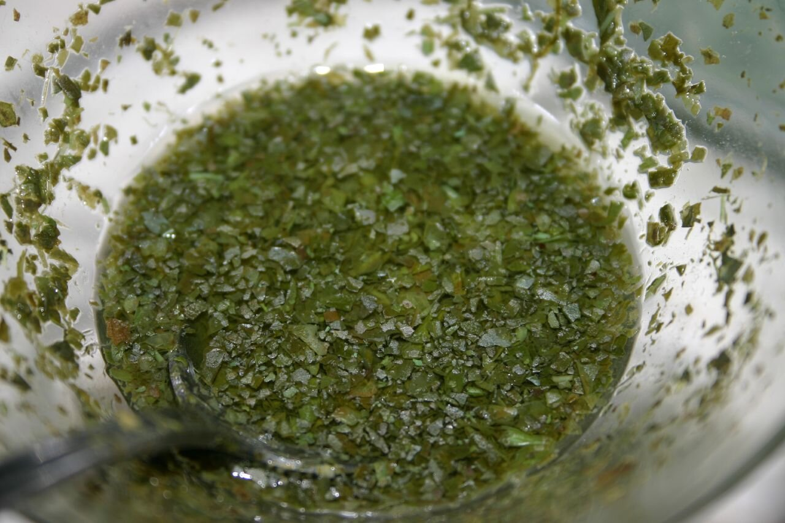

# Mint sauce (salsa inglesa de menta)

*Foto: [rjp](https://commons.wikimedia.org/wiki/File:Mint_Sauce.jpg), [CC BY-SA 2.0](https://creativecommons.org/licenses/by-sa/2.0/deed.es), vía Wikimedia Commons.*

Menta fresca picada con azúcar, agua hirviendo y vinagre de malta: la salsa inglesa del cordero asado del domingo.

🥄 Para **4 personas** · ⏱️ 10 minutos + 30 de reposo · Dificultad: fácil

*In English:* [Mint sauce](mint-sauce.en.md)

## Ingredientes

- 1 manojo grande de menta fresca (unos 30 g de hojas)
- 1 cucharada de azúcar
- Una pizca de sal
- 3 cucharadas de agua hirviendo
- 3-4 cucharadas de vinagre de malta (o de vino blanco)

## Preparación

1. **Picar.** Pica las hojas de menta muy finas con el azúcar y la sal; el azúcar ayuda a cortarlas.
2. **Escaldar.** Ponlas en un cuenco o una salsera y vierte el agua hirviendo por encima. Remueve hasta que se disuelva el azúcar.
3. **El vinagre.** Añade el vinagre y mezcla.
4. **Reposar.** Déjala 30 minutos para que la menta suelte el sabor.
5. **Servir.** Con cucharilla, sobre el cordero asado; también con guisantes.

## Consejos

- **Vinagre de malta:** es el tradicional; con vinagre de vino queda más suave.
- **Picada a mano:** la batidora la oscurece y la deja amarga.
- **Dura unos días** en la nevera, pero el color es mejor el primer día.
