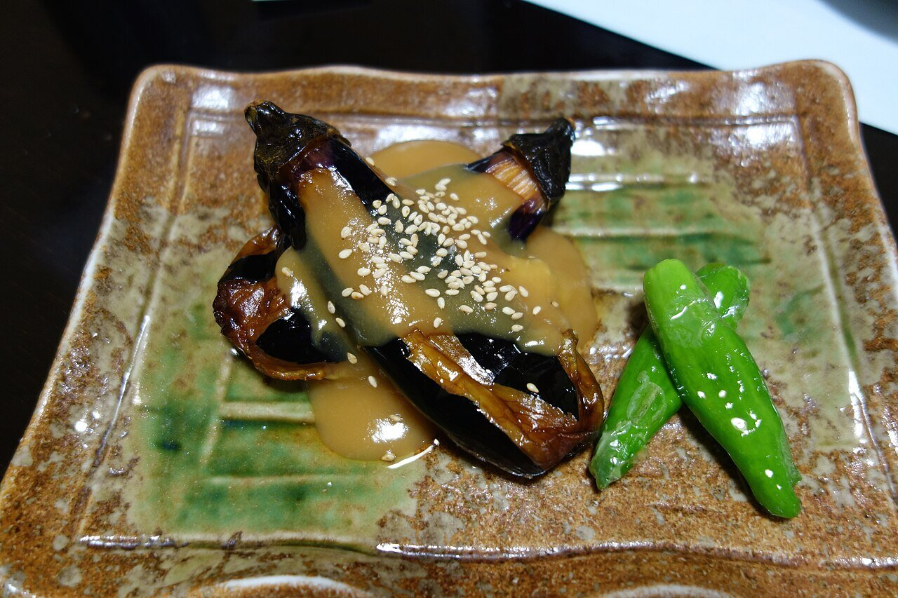

# Sweet miso glaze

*Photo: [pelican from Tokyo, Japan](https://commons.wikimedia.org/wiki/File:Nasu_dengaku_(15284831066).jpg), [CC BY-SA 2.0](https://creativecommons.org/licenses/by-sa/2.0/), via Wikimedia Commons.*

Miso, mirin, sake and sugar cooked into a glossy paste, with toasted sesame: the glaze for nasu dengaku (miso eggplant) and tofu dengaku.

🥄 Serves **4** · ⏱️ 10 minutes · Difficulty: easy

*En español:* [Miso dare (salsa dengaku)](miso-dare.es.md)

## Ingredients

- 3 tablespoons miso (red, white or a mix)
- 2 tablespoons mirin
- 1 tablespoon sake
- 1½ tablespoons sugar
- 1 teaspoon toasted sesame oil
- 1 tablespoon toasted sesame seeds, to serve

## Directions

1. **Mix.** In a small saucepan, stir together the miso, mirin, sake and sugar.
2. **Cook.** Cook over low heat 2–3 minutes, stirring constantly, until glossy and the alcohol has cooked off.
3. **Sesame.** Off the heat, stir in the sesame oil.
4. **Glaze.** Spread over roasted eggplant (or tofu), broil 2–3 minutes and sprinkle with sesame.

## Tips

- **Nasu dengaku:** halve 2 eggplants, score the flesh in a grid, roast 20 minutes at 400 °F and glaze.
- **Alcohol-free:** replace the sake and mirin with 2 tablespoons water and ½ tablespoon more sugar.
- **Vegan** if the miso has no fish dashi added.
