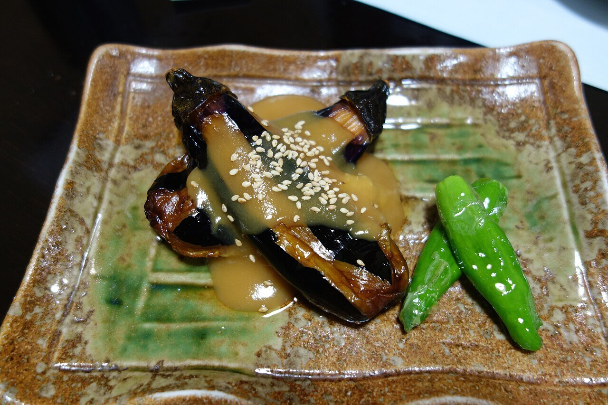

# Miso dare (salsa dengaku)

*Foto: [pelican from Tokyo, Japan](https://commons.wikimedia.org/wiki/File:Nasu_dengaku_(15284831066).jpg), [CC BY-SA 2.0](https://creativecommons.org/licenses/by-sa/2.0/deed.es), vía Wikimedia Commons.*

Miso, mirin, sake y azúcar cocidos hasta tener una pasta brillante, con sésamo tostado: la salsa del nasu dengaku (berenjena glaseada) y del tofu dengaku.

🥄 Para **4 personas** · ⏱️ 10 minutos · Dificultad: fácil

*In English:* [Sweet miso glaze](miso-dare.en.md)

## Ingredientes

- 3 cucharadas de miso (rojo o blanco, o mezcla)
- 2 cucharadas de mirin
- 1 cucharada de sake
- 1½ cucharadas de azúcar
- 1 cucharadita de aceite de sésamo tostado
- 1 cucharada de sésamo tostado, para servir

## Preparación

1. **Mezclar.** En un cazo pequeño, mezcla el miso, el mirin, el sake y el azúcar.
2. **Cocer.** Cuece a fuego suave 2–3 minutos, removiendo sin parar, hasta que brille y se evapore el alcohol.
3. **El sésamo.** Fuera del fuego, añade el aceite de sésamo.
4. **Glasear.** Unta la berenjena (o el tofu) ya asada, gratínala 2–3 minutos y espolvorea el sésamo.

## Consejos

- **Nasu dengaku:** corta 2 berenjenas por la mitad, haz cortes en rejilla, ásalas 20 minutos a 200 °C y glaséalas.
- **Sin alcohol:** cambia el sake y el mirin por 2 cucharadas de agua y ½ cucharada más de azúcar.
- **Vegana** si el miso no lleva dashi de pescado.
