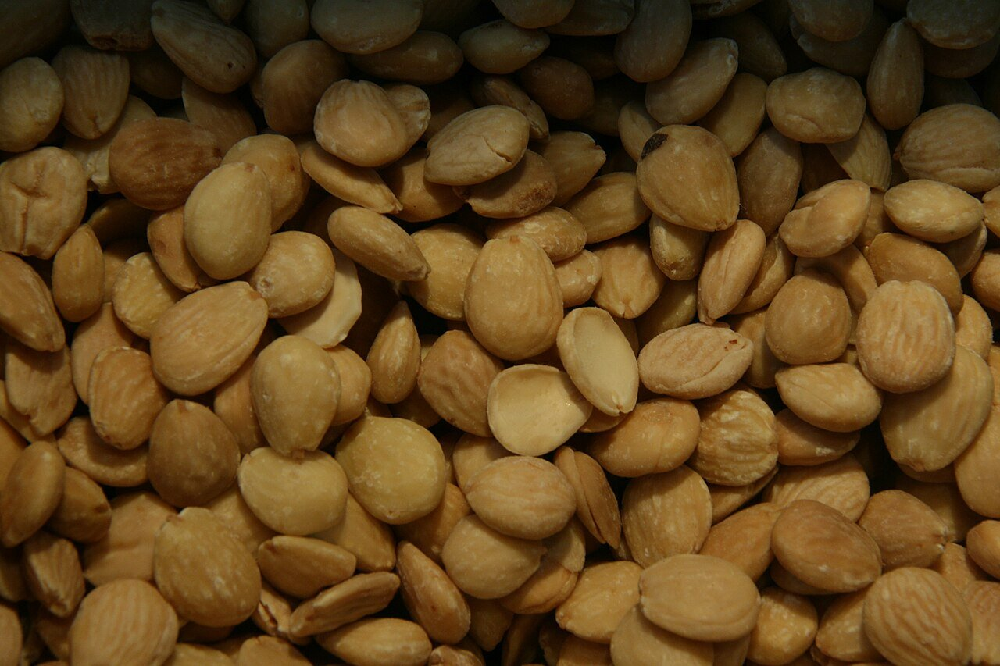

# Mojo de almendras

*Foto: [Tamorlan](https://commons.wikimedia.org/wiki/File:Almendra_marcona.jpg), [CC BY 3.0](https://creativecommons.org/licenses/by/3.0/deed.es), vía Wikimedia Commons.*

Almendras tostadas, ajo, pan, comino, aceite y vinagre majados en el mortero: un mojo canario de La Palma, vegano, sin alcohol y sin pimiento. La foto muestra las almendras, no el mojo.

🥄 Para **6 personas** · ⏱️ 15 minutos · Dificultad: fácil

*In English:* [Canarian almond mojo](mojo-almendras.en.md)

## Ingredientes

- 100 g de almendras tostadas
- 3 dientes de ajo
- 1 rebanada de pan duro
- ½ cucharadita de comino en grano
- 1 cucharadita de sal gruesa
- Unas hebras de azafrán (opcional)
- 100 ml de aceite de oliva
- 2–3 cucharadas de vinagre de vino
- Un poco de agua

## Preparación

1. **El pan.** Remoja el pan en el vinagre.
2. **Machacar.** En el mortero, machaca el comino con la sal, los ajos y el azafrán hasta tener una pasta.
3. **Las almendras.** Añade las almendras y el pan escurrido y machaca hasta que quede una pasta gruesa.
4. **Ligar.** Añade el aceite en un hilo, removiendo, y aclara con un poco de agua y el vinagre que sobre hasta tener una salsa espesa.

## Consejos

- **Con** papas arrugadas, pescado, conejo o verduras asadas.
- **Con batidora** sale más fino; en mortero queda más rústico.
- **Aguanta** 3–4 días en la nevera en un tarro cerrado.
