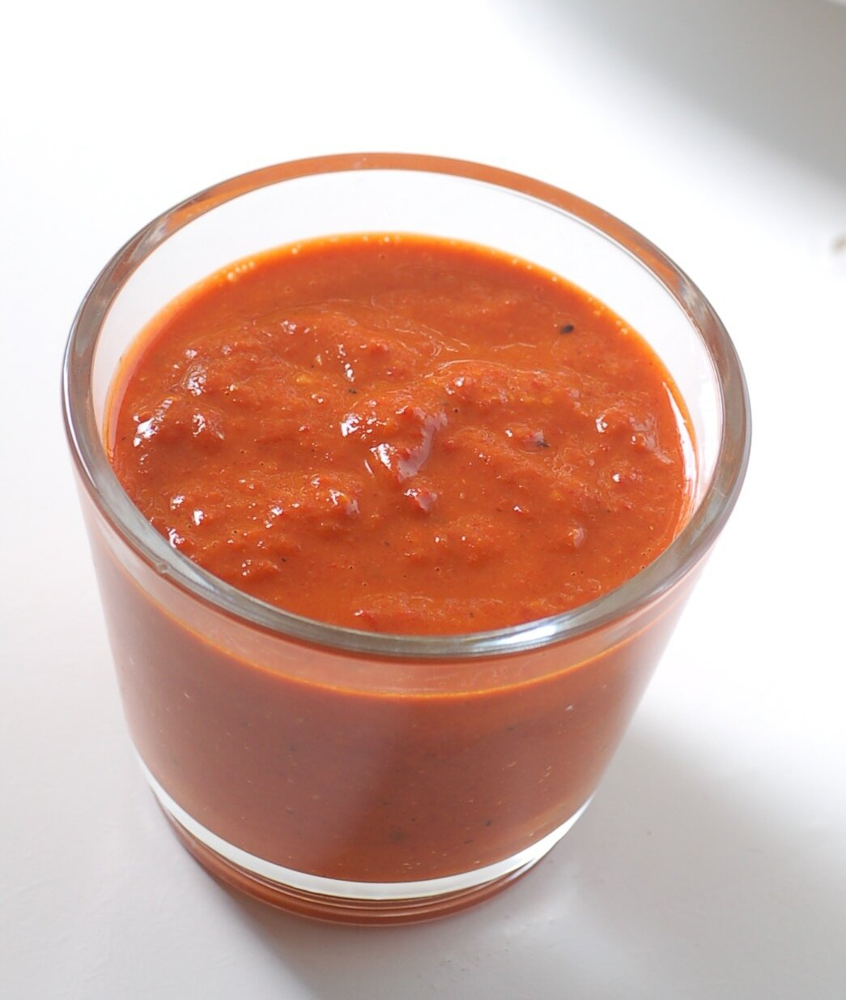

# Canarian red pepper sauce

*Photo: [jules](https://commons.wikimedia.org/wiki/File:Mojo_picon_(cropped).jpg), [CC BY 2.0](https://creativecommons.org/licenses/by/2.0/), via Wikimedia Commons.*

The red mojo of the Canary Islands: garlic, dried pepper, cumin, paprika, olive oil and vinegar.

🥄 Serves **6** · ⏱️ 15 minutes · Difficulty: easy

*En español:* [Mojo picón (mojo rojo)](mojo-picon.es.md)

## Ingredients

- 4 garlic cloves
- 2 dried Canarian peppers (or 1 small dried chile)
- 1 teaspoon cumin seeds
- 1 teaspoon coarse salt
- 1 tablespoon sweet Spanish paprika
- Scant ½ cup olive oil
- 3 tablespoons wine vinegar
- 1 slice stale bread (optional, to thicken)

## Directions

1. **Pepper.** Seed the peppers and soak them in warm water for 15 minutes.
2. **Pound.** In a mortar, crush the cumin with the salt, then add the garlic and drained pepper and pound into a paste.
3. **Paprika.** Add the paprika and, if using, the bread soaked in the vinegar.
4. **Emulsify.** Stream in the oil while stirring, then the vinegar. It should be a thick sauce.

## Tips

- **Serve with** Canarian wrinkled potatoes, pork or grilled cheese.
- **A blender** makes it smoother and faster.
- **Keeps a week** in the fridge in a sealed jar.
