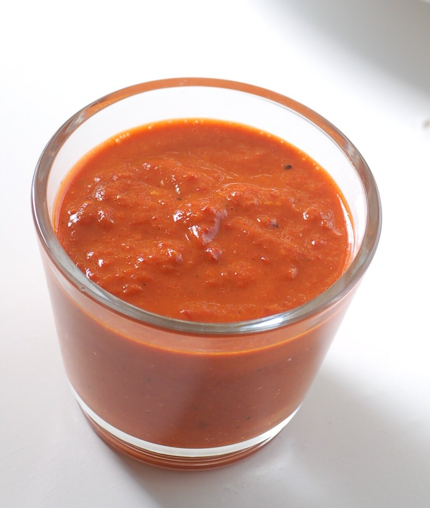

# Mojo picón (mojo rojo)

*Foto: [jules](https://commons.wikimedia.org/wiki/File:Mojo_picon_(cropped).jpg), [CC BY 2.0](https://creativecommons.org/licenses/by/2.0/deed.es), vía Wikimedia Commons.*

El mojo rojo canario: ajo, pimienta, comino, pimentón, aceite y vinagre.

🥄 Para **6 personas** · ⏱️ 15 minutos · Dificultad: fácil

*In English:* [Canarian red pepper sauce](mojo-picon.en.md)

## Ingredientes

- 4 dientes de ajo
- 2 pimientas palmeras secas (o 1 guindilla)
- 1 cucharadita de comino en grano
- 1 cucharadita de sal gruesa
- 1 cucharada de pimentón dulce
- 100 ml de aceite de oliva
- 3 cucharadas de vinagre de vino
- 1 rebanada de pan duro (opcional, para espesar)

## Preparación

1. **La pimienta.** Quita las semillas a las pimientas y remójalas 15 minutos en agua templada.
2. **Machacar.** En el mortero, machaca el comino con la sal, añade los ajos y la pimienta escurrida y haz una pasta.
3. **El pimentón.** Añade el pimentón y, si lo usas, el pan remojado en el vinagre.
4. **Ligar.** Añade el aceite en un hilo, removiendo, y luego el vinagre. Debe quedar como una salsa espesa.

## Consejos

- **Con papas arrugadas,** carne de cerdo o queso asado.
- **Con batidora** sale más fino y más rápido.
- **Aguanta una semana** en la nevera en un tarro cerrado.
