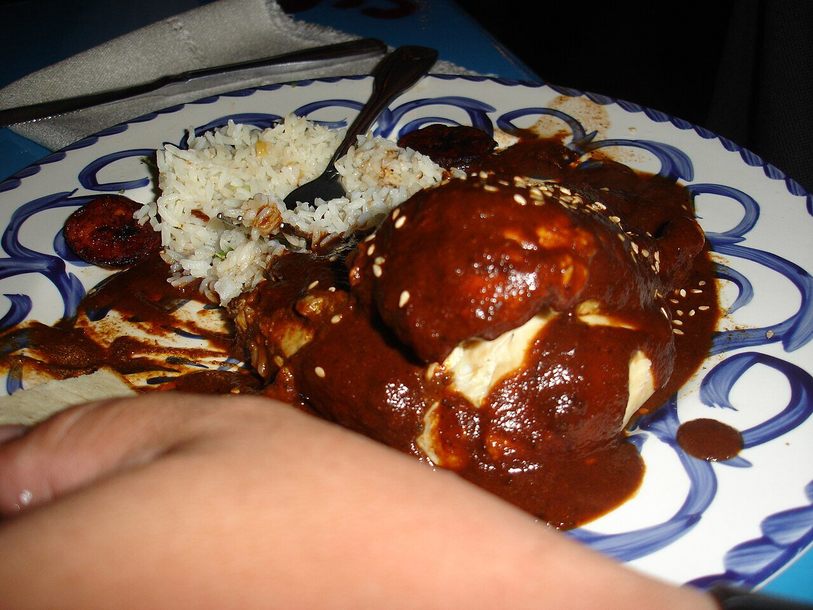

# Mole poblano

*Photo: [Melissa Doroquez](https://commons.wikimedia.org/wiki/File:Mole_Poblano.jpg), [CC BY-SA 2.0](https://creativecommons.org/licenses/by-sa/2.0/), via Wikimedia Commons.*

The sauce from Puebla: mild dried chiles, nuts, sesame, spices, tortilla and chocolate, ground and slowly simmered. With the chiles seeded and deveined, it's barely spicy.

🥄 Serves **6** · ⏱️ 1 h 30 min · Difficulty: hard · Heat: mild

*En español:* [Mole poblano](mole-poblano.es.md)

## Ingredients

- 3 ancho chiles
- 3 mulato chiles
- 2 pasilla chiles
- 1 tomato
- ½ onion
- 2 garlic cloves
- ¼ cup almonds
- ¼ cup peanuts
- 3 tablespoons sesame seeds (plus more to serve)
- ¼ cup raisins
- 1 stale corn tortilla (or 1 slice bread)
- ½ teaspoon cinnamon
- 2 cloves
- 2 oz Mexican table chocolate (or dark chocolate plus a pinch more cinnamon)
- 4 cups chicken stock
- 1 tablespoon sugar
- 4 tablespoons lard or oil
- Salt

## Directions

1. **Chiles.** Remove stems, seeds and veins. Toast a few seconds per side in a dry pan without burning, then soak 20 minutes in hot water.
2. **Fry.** In a little lard, fry the almonds, peanuts, sesame, raisins, torn tortilla, cinnamon and cloves separately, just until golden.
3. **Char.** Char the tomato, onion and garlic in the pan until blistered.
4. **Blend.** Blend the drained chiles with everything fried and charred and some of the stock into a very smooth paste. Strain if needed.
5. **Simmer.** Fry the paste in the rest of the lard over medium heat for 10 minutes, stirring. Add the remaining stock, chocolate, sugar and salt and simmer 30–40 minutes until thick and glossy.

## Tips

- **Serve with** poached chicken or turkey, enchiladas or red rice; sprinkle with toasted sesame.
- **Better the next day.** It freezes very well.
- **Can't find all three chiles?** Anchos alone work.
