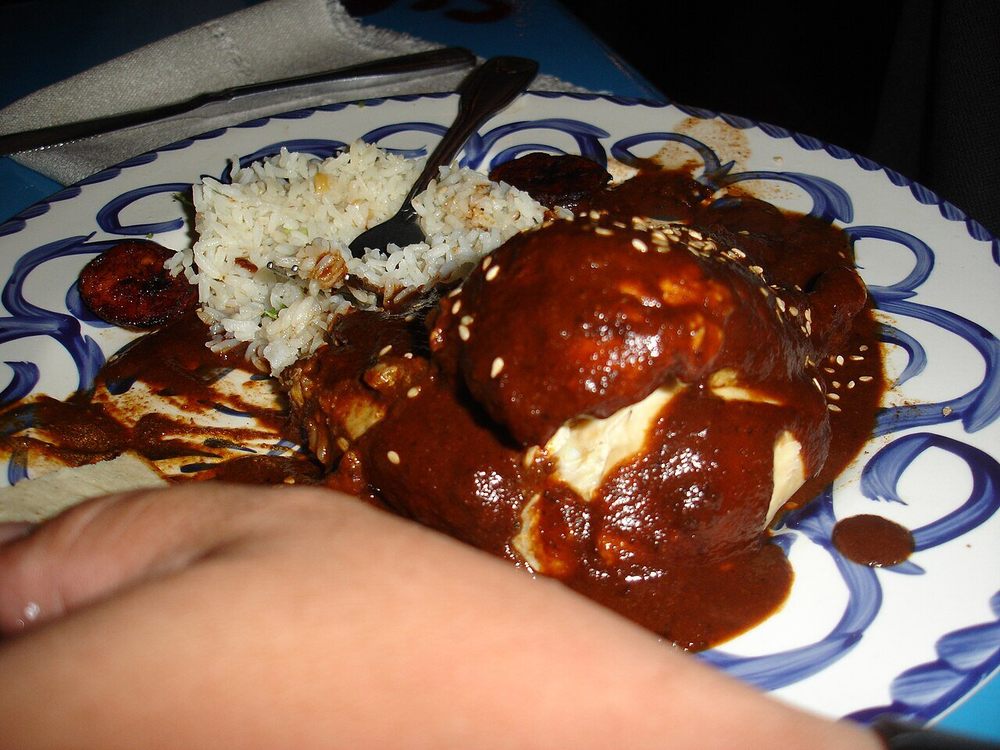

# Mole poblano

*Foto: [Melissa Doroquez](https://commons.wikimedia.org/wiki/File:Mole_Poblano.jpg), [CC BY-SA 2.0](https://creativecommons.org/licenses/by-sa/2.0/deed.es), vía Wikimedia Commons.*

La salsa de Puebla: chiles secos suaves, frutos secos, sésamo, especias, tortilla y chocolate, molidos y cocidos despacio. Con los chiles sin semillas ni venas, apenas pica.

🥄 Para **6 personas** · ⏱️ 1 h 30 min · Dificultad: difícil · Picor: suave

*In English:* [Mole poblano](mole-poblano.en.md)

## Ingredientes

- 3 chiles anchos
- 3 chiles mulatos
- 2 chiles pasilla
- 1 tomate
- ½ cebolla
- 2 dientes de ajo
- 30 g de almendras
- 30 g de cacahuetes
- 3 cucharadas de sésamo (y más para servir)
- 30 g de pasas
- 1 tortilla de maíz dura (o 1 rebanada de pan)
- ½ cucharadita de canela
- 2 clavos
- 50 g de chocolate de mesa mexicano (o chocolate negro y una pizca más de canela)
- 1 litro de caldo de pollo
- 1 cucharada de azúcar
- 4 cucharadas de manteca o de aceite
- Sal

## Preparación

1. **Los chiles.** Quítales el tallo, las semillas y las venas. Tuéstalos unos segundos por lado en una sartén seca, sin que se quemen, y remójalos 20 minutos en agua caliente.
2. **Freír.** En un poco de manteca, fríe por separado las almendras, los cacahuetes, el sésamo, las pasas, la tortilla troceada, la canela y los clavos, solo hasta que se doren.
3. **Asar.** Asa el tomate, la cebolla y el ajo en la sartén hasta que estén tostados.
4. **Moler.** Tritura los chiles escurridos con todo lo frito y lo asado y con parte del caldo, hasta tener una pasta muy fina. Cuélala si hace falta.
5. **Cocer.** Fríe la pasta en el resto de la manteca a fuego medio 10 minutos, removiendo. Añade el resto del caldo, el chocolate, el azúcar y la sal y cuece a fuego suave 30–40 minutos, hasta que espese y brille.

## Consejos

- **Con** pollo o pavo cocido, enchiladas o arroz rojo; espolvorea sésamo tostado por encima.
- **Mejor al día siguiente.** Se congela muy bien.
- **Si no encuentras los tres chiles,** puedes hacerlo solo con anchos.
