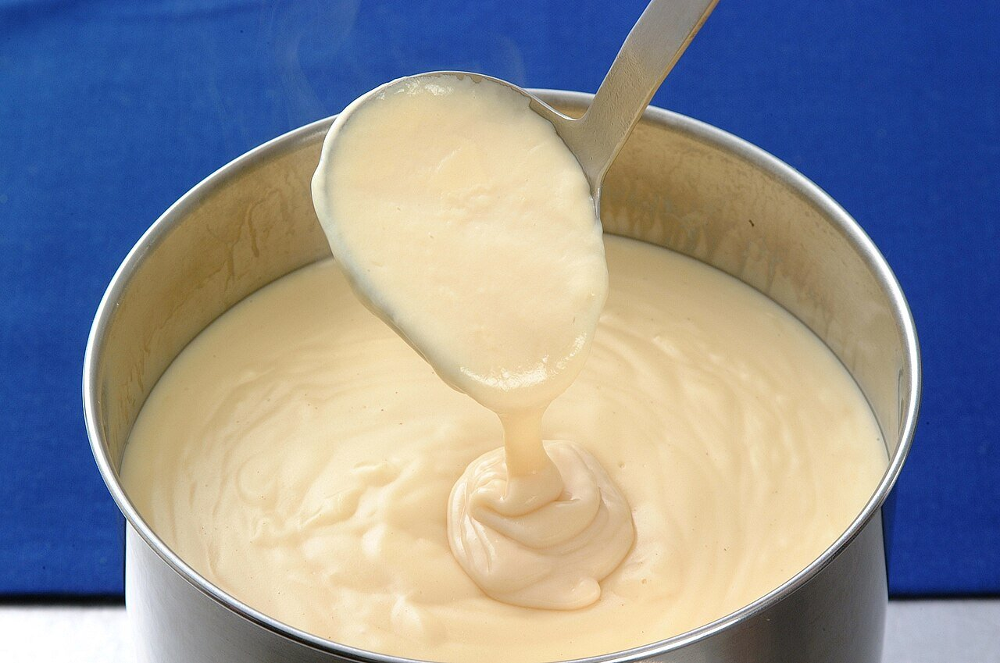

# Mornay cheese sauce

*Photo: [赤犬](https://commons.wikimedia.org/wiki/File:%E3%83%A2%E3%83%AB%E3%83%8D%E3%83%BC%E3%82%BD%E3%83%BC%E3%82%B9.jpg), [CC BY-SA 3.0](https://creativecommons.org/licenses/by-sa/3.0/), via Wikimedia Commons.*

Béchamel enriched with Gruyère and egg yolk: the sauce for gratins, croque-monsieur and baked cauliflower.

🥄 Makes **about 2½ cups** · ⏱️ 20 minutes · Difficulty: easy

*En español:* [Salsa Mornay (sauce Mornay)](mornay.es.md)

## Ingredients

- 3 tablespoons butter
- ⅓ cup all-purpose flour
- 2 cups whole milk
- 1 cup grated Gruyère (or Emmental)
- 1 egg yolk (optional)
- 1 pinch nutmeg
- Salt

## Directions

1. **Béchamel.** Melt the butter, add the flour and cook 2 minutes. Whisk in the hot milk and simmer 5–8 minutes until thick.
2. **Cheese.** Off the heat, stir in the grated cheese until melted.
3. **Yolk.** If using, whisk it with 2 tablespoons of the sauce and stir it into the pan.
4. **Finish.** Add the nutmeg and taste before salting: the cheese is salty.

## Tips

- **To gratinate:** cover vegetables, fish or pasta, sprinkle more cheese and broil until golden.
- **Croque-monsieur:** sandwich bread, ham, the sauce and cheese, baked.
- **Don't boil it** once the cheese and yolk are in.
