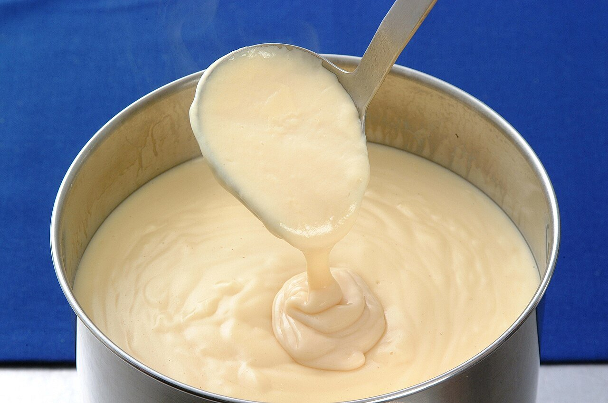

# Salsa Mornay (sauce Mornay)

*Foto: [赤犬](https://commons.wikimedia.org/wiki/File:%E3%83%A2%E3%83%AB%E3%83%8D%E3%83%BC%E3%82%BD%E3%83%BC%E3%82%B9.jpg), [CC BY-SA 3.0](https://creativecommons.org/licenses/by-sa/3.0/deed.es), vía Wikimedia Commons.*

Bechamel enriquecida con queso gruyer y yema de huevo: la salsa de los gratinados, el croque-monsieur y la coliflor al horno.

🥄 Para **unos 600 ml** · ⏱️ 20 minutos · Dificultad: fácil

*In English:* [Mornay cheese sauce](mornay.en.md)

## Ingredientes

- 40 g de mantequilla
- 40 g de harina
- 500 ml de leche entera
- 100 g de queso gruyer (o emmental) rallado
- 1 yema de huevo (opcional)
- 1 pizca de nuez moscada
- Sal

## Preparación

1. **La bechamel.** Funde la mantequilla, añade la harina y cocínala 2 minutos. Añade la leche caliente batiendo y cuece 5–8 minutos hasta que espese.
2. **El queso.** Fuera del fuego, añade el queso rallado y remueve hasta que se funda.
3. **La yema.** Si la usas, bátela con 2 cucharadas de la salsa y añádela al cazo, removiendo.
4. **Terminar.** Añade la nuez moscada y prueba antes de salar: el queso ya es salado.

## Consejos

- **Para gratinar:** cubre verduras, pescado o pasta, espolvorea más queso y gratina hasta que se dore.
- **Croque-monsieur:** pan de molde, jamón cocido, la salsa y queso, al horno.
- **No la hiervas** después de añadir el queso y la yema.
