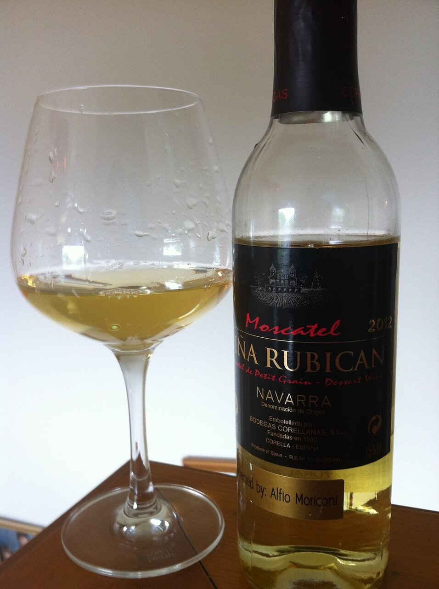

# Muscat wine sauce with raisins and pine nuts

*Photo: [Agne27](https://commons.wikimedia.org/wiki/File:Navarra_Moscatel.jpg), [CC BY-SA 3.0](https://creativecommons.org/licenses/by-sa/3.0/), via Wikimedia Commons.*

Muscat wine reduced with shallot, raisins and toasted pine nuts: a sweet-sour sauce for pork tenderloin, duck or foie gras. The photo shows the wine, not the dish.

🥄 Serves **4** · ⏱️ 25 minutes · Difficulty: easy

*En español:* [Salsa al moscatel con pasas y piñones](moscatel.es.md)

## Ingredients

- 1 shallot
- ¾ cup plus 1 tablespoon sweet Muscat wine (Spanish moscatel)
- ¾ cup plus 1 tablespoon beef or chicken stock
- ¼ cup raisins
- 2 tablespoons pine nuts
- 1 thyme sprig
- 1½ tablespoons cold butter
- 1 tablespoon olive oil
- Salt

## Directions

1. **Raisins.** Soak them in half the wine for 15 minutes. Toast the pine nuts in a dry pan.
2. **Shallot.** Gently cook the chopped shallot in the oil for 5 minutes.
3. **Reduce.** Add all the wine (with the raisins) and the thyme and reduce by half.
4. **Stock.** Add the stock and reduce again until it coats a spoon.
5. **Mount.** Remove the thyme and, off the heat, whisk in the cold butter in cubes and add the pine nuts. Season with salt.

## Tips

- **Pork tenderloin in Muscat:** sear the tenderloin, make the sauce in the same pan and finish the meat in it for 5 minutes.
- **Also with** duck, seared foie gras, quail or goat cheese.
- **Balance the sweetness** with a few drops of sherry vinegar.
