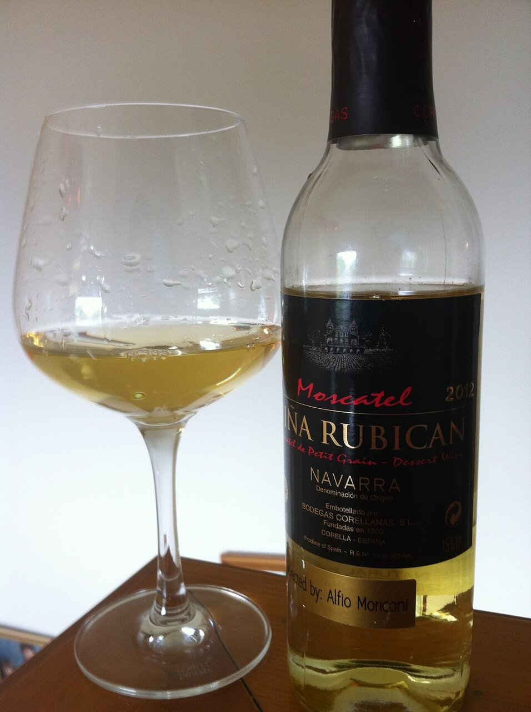

# Salsa al moscatel con pasas y piñones

*Foto: [Agne27](https://commons.wikimedia.org/wiki/File:Navarra_Moscatel.jpg), [CC BY-SA 3.0](https://creativecommons.org/licenses/by-sa/3.0/deed.es), vía Wikimedia Commons.*

Vino moscatel reducido con chalota, pasas y piñones tostados: una salsa agridulce para solomillo de cerdo, pato o foie. La foto muestra el vino, no el plato.

🥄 Para **4 personas** · ⏱️ 25 minutos · Dificultad: fácil

*In English:* [Muscat wine sauce with raisins and pine nuts](moscatel.en.md)

## Ingredientes

- 1 chalota
- 200 ml de vino moscatel (de Málaga, Valencia o Navarra)
- 200 ml de caldo de carne o de pollo
- 30 g de pasas
- 20 g de piñones
- 1 ramita de tomillo
- 20 g de mantequilla fría
- 1 cucharada de aceite de oliva
- Sal

## Preparación

1. **Las pasas.** Remójalas en la mitad del moscatel 15 minutos. Tuesta los piñones en una sartén seca.
2. **La chalota.** Pocha la chalota picada en el aceite a fuego suave 5 minutos.
3. **Reducir.** Añade todo el moscatel (con las pasas) y el tomillo y reduce a la mitad.
4. **El caldo.** Añade el caldo y reduce otra vez hasta que la salsa napee la cuchara.
5. **Montar.** Retira el tomillo y, fuera del fuego, añade la mantequilla fría en dados y los piñones. Ajusta de sal.

## Consejos

- **Solomillo al moscatel:** marca el solomillo, haz la salsa en la misma sartén y termina la carne 5 minutos en ella.
- **Con** pato, foie a la plancha, codornices o queso de cabra.
- **Equilibra el dulzor** con unas gotas de vinagre de Jerez.
