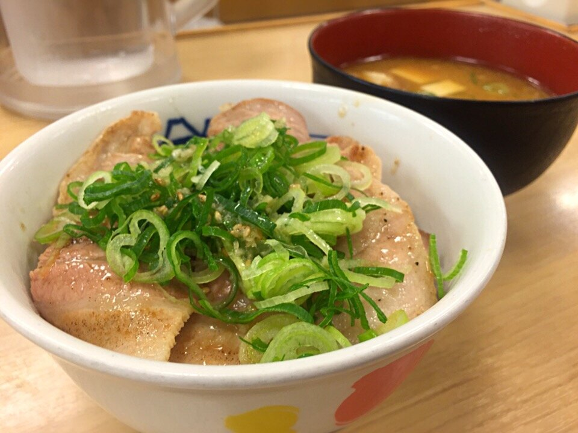

# Japanese scallion and sesame oil sauce

*Photo: [hirotomo t from japan](https://commons.wikimedia.org/wiki/File:%E3%83%8D%E3%82%AE%E5%A1%A9%E8%B1%9A%E3%82%AB%E3%83%AB%E3%83%93%E4%B8%BC%E3%81%A8%E8%B1%9A%E6%B1%81_(15483545291).jpg), [CC BY-SA 2.0](https://creativecommons.org/licenses/by-sa/2.0/), via Wikimedia Commons.*

Finely chopped scallion with sesame oil, salt, lemon and garlic: the Japanese sauce for grilled meat, chicken and rice bowls. Vegan, with no alcohol and no peppers.

🥄 Serves **4** · ⏱️ 10 minutes · Difficulty: easy

*En español:* [Negi shio dare (salsa de cebolleta y sésamo)](negi-shio.es.md)

## Ingredients

- 2 scallions (white part and some green)
- 3 tablespoons toasted sesame oil
- 1 tablespoon lemon juice
- ½ teaspoon salt
- 1 garlic clove, grated
- ½ teaspoon sugar
- 1 teaspoon toasted white sesame seeds

## Directions

1. **Chop.** Chop the scallion as finely as possible.
2. **Mix.** In a bowl, mix the scallion with the salt, sugar, garlic and lemon juice.
3. **Sesame.** Add the sesame oil and seeds and mix well.
4. **Rest.** Let it sit 10 minutes so the scallion softens slightly.

## Tips

- **Serve with** grilled meat (especially beef tongue, gyutan), chicken, pork, tofu or a rice bowl.
- **Milder:** blanch the chopped scallion 10 seconds in boiling water and drain.
- **Keeps** 2–3 days in the fridge.
