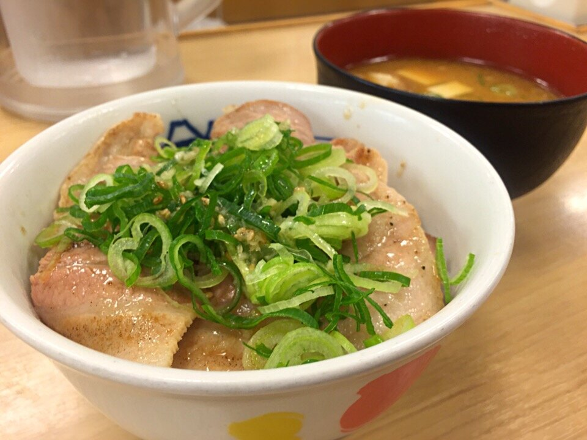

# Negi shio dare (salsa de cebolleta y sésamo)

*Foto: [hirotomo t from japan](https://commons.wikimedia.org/wiki/File:%E3%83%8D%E3%82%AE%E5%A1%A9%E8%B1%9A%E3%82%AB%E3%83%AB%E3%83%93%E4%B8%BC%E3%81%A8%E8%B1%9A%E6%B1%81_(15483545291).jpg), [CC BY-SA 2.0](https://creativecommons.org/licenses/by-sa/2.0/deed.es), vía Wikimedia Commons.*

Cebolleta muy picada con aceite de sésamo, sal, limón y ajo: la salsa japonesa para la carne a la parrilla, el pollo y los cuencos de arroz. Vegana, sin alcohol y sin pimiento.

🥄 Para **4 personas** · ⏱️ 10 minutos · Dificultad: fácil

*In English:* [Japanese scallion and sesame oil sauce](negi-shio.en.md)

## Ingredientes

- 2 cebolletas (la parte blanca y un poco de la verde)
- 3 cucharadas de aceite de sésamo tostado
- 1 cucharada de zumo de limón
- ½ cucharadita de sal
- 1 diente de ajo rallado
- ½ cucharadita de azúcar
- 1 cucharadita de sésamo blanco tostado

## Preparación

1. **Picar.** Pica la cebolleta lo más fina posible.
2. **Mezclar.** En un bol, mezcla la cebolleta con la sal, el azúcar, el ajo y el limón.
3. **El sésamo.** Añade el aceite de sésamo y las semillas y mezcla bien.
4. **Reposar.** Deja reposar 10 minutos para que la cebolleta se ablande un poco.

## Consejos

- **Con** carne a la parrilla (sobre todo lengua de ternera, gyutan), pollo, cerdo, tofu o un cuenco de arroz.
- **Más suave:** escalda la cebolleta picada 10 segundos en agua hirviendo y escúrrela.
- **Aguanta** 2–3 días en la nevera.
