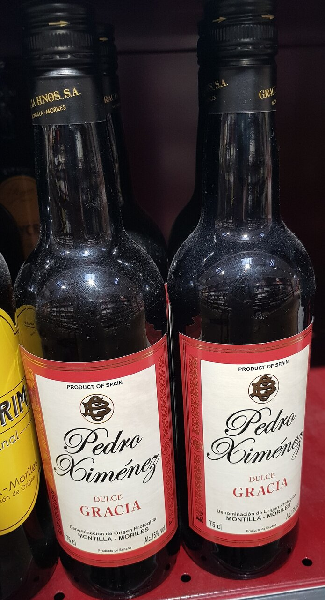

# Pedro Ximénez sherry reduction

*Photo: [Tyk](https://commons.wikimedia.org/wiki/File:Pedro_Xim%C3%A9nez_Dulce_Gracia_20240906_183448.jpg), [CC BY-SA 4.0](https://creativecommons.org/licenses/by-sa/4.0/), via Wikimedia Commons.*

A reduction of sweet Pedro Ximénez sherry with stock and butter: dark, glossy and sweet-sour. The photo shows the wine, not the dish.

🥄 Serves **4** · ⏱️ 20 minutes · Difficulty: easy

*En español:* [Salsa al Pedro Ximénez](pedro-ximenez.es.md)

## Ingredients

- 1 shallot (or ½ small onion)
- ¾ cup plus 1 tablespoon Pedro Ximénez sherry
- ¾ cup plus 1 tablespoon dark beef stock
- 1 teaspoon sherry vinegar
- 1 thyme or rosemary sprig
- 1½ tablespoons cold butter
- 1 tablespoon olive oil
- Salt and pepper

## Directions

1. **Shallot.** Gently cook the finely chopped shallot in the oil for about 5 minutes.
2. **Wine.** Add the Pedro Ximénez and herb and reduce by half over medium heat, about 8 minutes.
3. **Stock.** Add the stock and reduce again until it has the texture of a light syrup.
4. **Balance.** Add the sherry vinegar to cut the sweetness and season with salt and pepper.
5. **Mount.** Strain the sauce and, off the heat, whisk in the cold butter in cubes until glossy.

## Tips

- **Pork cheeks in Pedro Ximénez:** braise pork cheeks with vegetables and stock, and add the sauce at the end.
- **Also with** tenderloin, duck breast, foie gras, blue cheese or even vanilla ice cream (skip the shallot and stock).
- **Watch the reduction:** the wine's sugar burns quickly.
