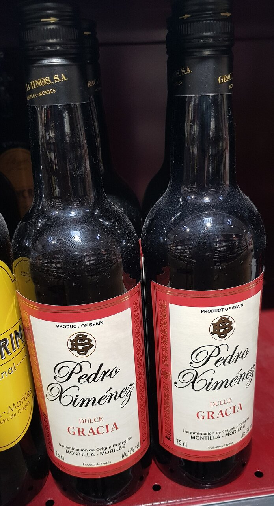

# Salsa al Pedro Ximénez

*Foto: [Tyk](https://commons.wikimedia.org/wiki/File:Pedro_Xim%C3%A9nez_Dulce_Gracia_20240906_183448.jpg), [CC BY-SA 4.0](https://creativecommons.org/licenses/by-sa/4.0/deed.es), vía Wikimedia Commons.*

Reducción de vino dulce Pedro Ximénez con caldo y mantequilla, oscura, brillante y agridulce. La foto muestra el vino, no el plato.

🥄 Para **4 personas** · ⏱️ 20 minutos · Dificultad: fácil

*In English:* [Pedro Ximénez sherry reduction](pedro-ximenez.en.md)

## Ingredientes

- 1 chalota (o ½ cebolla pequeña)
- 200 ml de vino Pedro Ximénez
- 200 ml de caldo oscuro de carne
- 1 cucharadita de vinagre de Jerez
- 1 ramita de tomillo o romero
- 20 g de mantequilla fría
- 1 cucharada de aceite de oliva
- Sal y pimienta

## Preparación

1. **La chalota.** Pocha la chalota muy picada en el aceite a fuego suave unos 5 minutos.
2. **El vino.** Añade el Pedro Ximénez y la hierba y deja reducir a la mitad a fuego medio, unos 8 minutos.
3. **El caldo.** Añade el caldo y reduce otra vez hasta que la salsa tenga textura de jarabe ligero.
4. **El equilibrio.** Añade el vinagre de Jerez para cortar el dulzor y ajusta de sal y pimienta.
5. **Montar.** Cuela la salsa y, fuera del fuego, añade la mantequilla fría en dados, removiendo hasta que brille.

## Consejos

- **Carrilleras al Pedro Ximénez:** guisa las carrilleras con verduras y caldo, y añade la salsa al final.
- **Con** solomillo, magret de pato, foie, queso azul o incluso helado de vainilla (sin la chalota ni el caldo).
- **Vigila la reducción:** el azúcar del vino se quema rápido.
