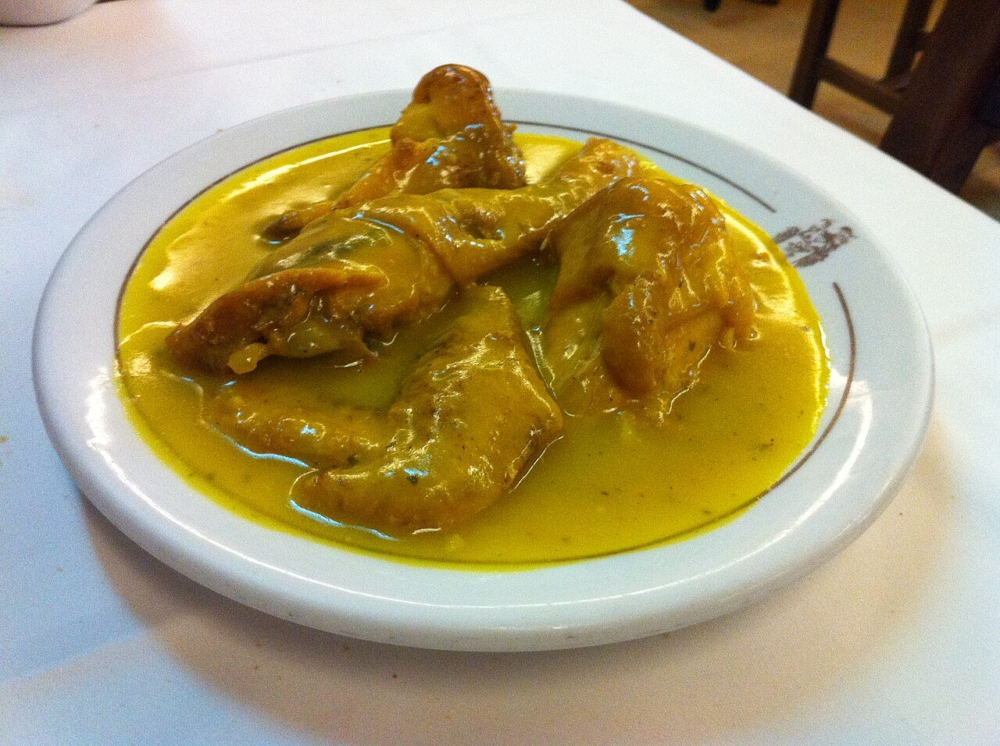

# Almond, saffron and white wine sauce

*Photo: [Tamorlan](https://commons.wikimedia.org/wiki/File:Gallina_en_Pepitoria_(Ciriaco).JPG), [CC BY-SA 3.0](https://creativecommons.org/licenses/by-sa/3.0/), via Wikimedia Commons.*

The sauce for Spanish chicken or hen en pepitoria: white wine, almonds, saffron and hard-boiled egg yolk.

🥄 Serves **4** · ⏱️ 1 h 15 min · Difficulty: medium

*En español:* [Salsa en pepitoria](pepitoria.es.md)

## Ingredients

- 1 chicken or stewing hen, cut up (about 3¼ lb)
- 1 onion
- 2 garlic cloves
- ¾ cup plus 2 tablespoons dry white wine
- 2 cups chicken stock
- 1 bay leaf
- **For the paste**
- ¼ cup blanched raw almonds
- 2 hard-boiled eggs (yolks)
- A few saffron threads
- 1 parsley sprig
- All-purpose flour, for dredging
- 6 tablespoons olive oil
- Salt and pepper

## Directions

1. **Brown.** Season and dredge the meat in flour, brown it in the oil and set aside. In the same oil, fry the almonds until golden and set them aside.
2. **Base.** Gently cook the chopped onion and garlic for about 10 minutes.
3. **Wine.** Return the meat, pour in the wine and let the alcohol cook off. Add the stock and bay leaf.
4. **Braise.** Simmer, covered, for 40 minutes for chicken (1 h 30 min or more for a stewing hen).
5. **Paste.** Pound the fried almonds, egg yolks, saffron and parsley in a mortar, thin with a little stock and stir into the pot. Simmer 10 more minutes.

## Tips

- **Chop the egg whites** and sprinkle them on top to serve.
- **For a smoother sauce,** blend and strain it before adding the paste.
- **Serve with** fries or white rice.
