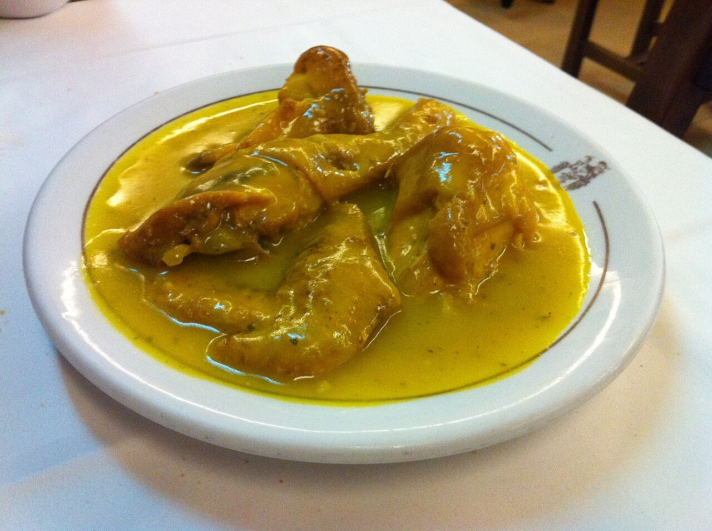

# Salsa en pepitoria

*Foto: [Tamorlan](https://commons.wikimedia.org/wiki/File:Gallina_en_Pepitoria_(Ciriaco).JPG), [CC BY-SA 3.0](https://creativecommons.org/licenses/by-sa/3.0/deed.es), vía Wikimedia Commons.*

La salsa de la gallina y el pollo en pepitoria: vino blanco, almendras, azafrán y yema de huevo cocida.

🥄 Para **4 personas** · ⏱️ 1 h 15 min · Dificultad: media

*In English:* [Almond, saffron and white wine sauce](pepitoria.en.md)

## Ingredientes

- 1 gallina o 1 pollo troceado (unos 1,5 kg)
- 1 cebolla
- 2 dientes de ajo
- 200 ml de vino blanco seco
- 500 ml de caldo de pollo
- 1 hoja de laurel
- **Para el majado**
- 30 g de almendras crudas peladas
- 2 huevos cocidos (las yemas)
- Unas hebras de azafrán
- 1 ramita de perejil
- Harina, para enharinar
- 6 cucharadas de aceite de oliva
- Sal y pimienta

## Preparación

1. **Dorar.** Salpimienta y enharina la carne, dórala en el aceite y retírala. En el mismo aceite, fríe las almendras hasta que estén doradas y resérvalas.
2. **El sofrito.** Pocha la cebolla y el ajo picados a fuego suave unos 10 minutos.
3. **El vino.** Vuelve a meter la carne, moja con el vino y deja que se evapore el alcohol. Añade el caldo y el laurel.
4. **Guisar.** Cuece tapado a fuego suave 40 minutos para el pollo (1 h 30 min o más para la gallina).
5. **El majado.** Machaca en el mortero las almendras fritas, las yemas cocidas, el azafrán y el perejil, diluye con un poco del caldo y añádelo al guiso. Cuece 10 minutos más.

## Consejos

- **Las claras** cocidas se pican y se echan por encima al servir.
- **Más fina:** tritura y cuela la salsa antes de añadir el majado.
- **Con** patatas fritas o arroz blanco.
