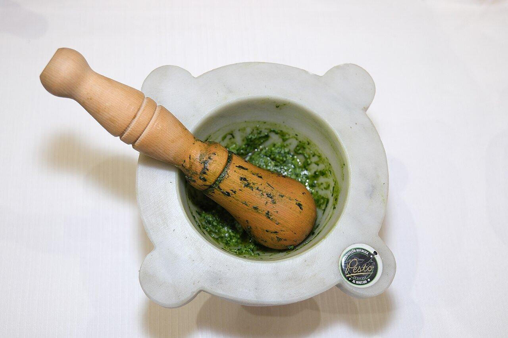

# Genoese basil pesto

*Photo: [AlfonsoLucifredi](https://commons.wikimedia.org/wiki/File:Pesto_alla_genovese.jpg), [CC BY-SA 4.0](https://creativecommons.org/licenses/by-sa/4.0/), via Wikimedia Commons.*

Basil, pine nuts, garlic, parmesan, pecorino and olive oil pounded in a mortar: the raw sauce from Genoa.

🥄 Serves **4** · ⏱️ 15 minutes · Difficulty: easy

*En español:* [Pesto genovés (pesto alla genovese)](pesto.es.md)

## Ingredients

- 2 oz fresh basil leaves (about 2 packed cups)
- ¼ cup pine nuts
- 1 garlic clove
- ½ cup grated parmesan
- ¼ cup grated pecorino
- Scant ½ cup mild extra virgin olive oil
- 1 pinch coarse salt

## Directions

1. **Garlic.** In a mortar, crush the garlic with the salt into a paste.
2. **Pine nuts.** Add the pine nuts and crush them.
3. **Basil.** Add the clean, very dry leaves gradually and grind them with a circular motion, not pounding, until they release a green liquid.
4. **Cheese and oil.** Add the cheeses and, last, the oil in a thin stream, stirring with the pestle.

## Tips

- **Food processor:** use a chilled bowl and short pulses so the basil doesn't warm up and darken.
- **Serve with** trofie or trenette with potato and green beans, as in Liguria, or in minestrone.
- **Vegan:** replace the cheeses with 2 tablespoons nutritional yeast and a few more pine nuts.
