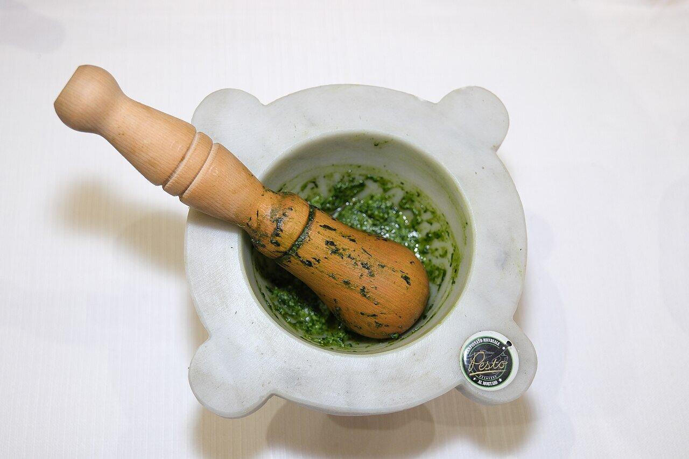

# Pesto genovés (pesto alla genovese)

*Foto: [AlfonsoLucifredi](https://commons.wikimedia.org/wiki/File:Pesto_alla_genovese.jpg), [CC BY-SA 4.0](https://creativecommons.org/licenses/by-sa/4.0/deed.es), vía Wikimedia Commons.*

Albahaca, piñones, ajo, parmesano, pecorino y aceite de oliva majados en el mortero: la salsa cruda de Génova.

🥄 Para **4 personas** · ⏱️ 15 minutos · Dificultad: fácil

*In English:* [Genoese basil pesto](pesto.en.md)

## Ingredientes

- 50 g de hojas de albahaca fresca
- 30 g de piñones
- 1 diente de ajo
- 40 g de parmesano rallado
- 20 g de pecorino rallado
- 100 ml de aceite de oliva virgen extra suave
- 1 pizca de sal gruesa

## Preparación

1. **El ajo.** En el mortero, machaca el ajo con la sal hasta hacer una pasta.
2. **Los piñones.** Añade los piñones y machácalos.
3. **La albahaca.** Añade las hojas, limpias y bien secas, poco a poco, y machácalas con un movimiento circular, sin golpear, hasta que suelten un líquido verde.
4. **El queso y el aceite.** Añade los quesos y, al final, el aceite en un hilo, removiendo con la mano del mortero.

## Consejos

- **Con batidora:** usa el vaso frío y pulsos cortos, para que la albahaca no se caliente y se oscurezca.
- **Con** trofie, trenette, patata y judías verdes, como en Liguria, o en sopa minestrone.
- **Vegano:** cambia los quesos por 2 cucharadas de levadura nutricional y un poco más de piñones.
