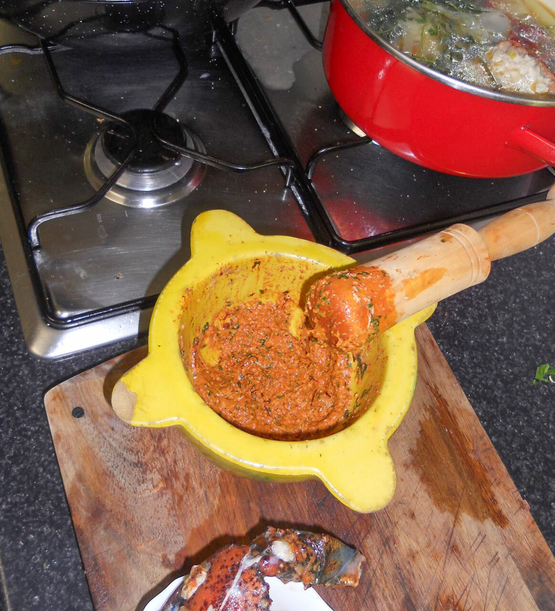

# Catalan nut and garlic paste

*Photo: [PachuliYo](https://commons.wikimedia.org/wiki/File:Picada_catalana.jpg), [CC BY-SA 4.0](https://creativecommons.org/licenses/by-sa/4.0/), via Wikimedia Commons.*

A pounded paste of nuts, garlic, fried bread and parsley stirred into Catalan stews at the end to thicken and flavor them.

🥄 Enough for **a stew for 4** · ⏱️ 10 minutes · Difficulty: easy

*En español:* [Picada catalana](picada.es.md)

## Ingredients

- 15 toasted almonds
- 10 toasted hazelnuts
- 2 garlic cloves
- 1 slice bread, fried in olive oil
- 1 parsley sprig
- A few saffron threads (optional)
- 2–3 tablespoons liquid from the stew

## Directions

1. **Bread.** Fry the bread in olive oil until golden.
2. **Pound.** In a mortar, crush the garlic with the parsley and saffron.
3. **Nuts.** Add the almonds, hazelnuts and torn bread and pound into a coarse paste.
4. **Thin.** Stir in the stew liquid. Add it to the stew for the last 5–10 minutes of cooking.

## Tips

- **Use it in** meat stews, fish stews, meatballs with cuttlefish or snails.
- **Variations:** pine nuts, dark chocolate, plain biscuits or fried liver, depending on the dish.
- **Don't cook it long** or the aroma fades.
